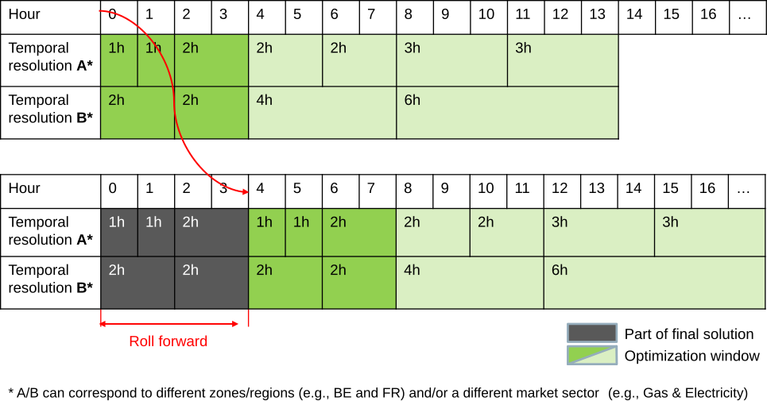

# Temporal Framework

SpineOpt aims to provide a high degree of flexibility in the temporal dimension across different components of the created model. This means that the user has some freedom to choose how the temporal aspects of different components of the model are defined. This freedom increases the variety of problems that can be tackled in SpineOpt: from very coarse, long term models, to very detailed models with a more limited horizon, or a mix of both. The choice of the user on how this flexibility is used will lead to the temporal structure of the model.

The main components of flexibility consist of the following parts:
  * The horizon that is modeled: end and start time
  * Temporal resolution
  * Possibility of a rolling optimization window
  * Support for commonly used methods such as representative days (see the [Representative periods tutorial](@ref))

Part of the temporal flexibility in SpineOpt is due to the fact that these options mentioned above can be implemented differently across different components of the model, which can be very useful when different markets are coupled in a single model. The resolution and horizon of the gas market can for example be taken differently than that of the electricity market. This documentation aims to give the reader insight in how these aspects are defined, and which entity classes are used for this.

We start by introducing the relevant entity classes with their parameters, and the relevant multidimensional entity classes for the temporal structure. Afterwards, we will discuss how this setting creates flexibility and will present some of the practical approaches to create a variety of temporal structures.

## Entity classes and their parameters
In this section, the entity classes that together form the temporal structure will be discussed.

### Entity classes relevant for the temporal framework
For these entity classes, the relevant parameters will also be introduced, along with the type of values that are allowed, following the format below:  

* 'parameter_name' : "Allowed value type"

#### The [model](@ref) entity class
Each [model](@ref) entity holds general information about the model at hand. Here we only discuss the time related parameters:
* [model\_start](@ref) and [model\_end](@ref) : "Date time value"
These two parameters define the model horizon. A `DateTime` value is to be taken for both parameters, in which case they directly mark respectively the beginning and end of the modeled time horizon.

* [duration\_unit](@ref) (optional): "minute or hour"
 This parameter gives the unit of duration that is used in the model calculations. The default value for this parameter is 'hour'.
 E.g. if the [duration\_unit](@ref) is set to `hour`, a `Duration` of one `minute` gets converted into `1/60 hours` for the calculations.

* [roll\_forward](@ref) (optional): "duration value"
This parameter defines how much the optimization window rolls forward in a rolling horizon optimization and should be expressed as a duration. In the practical approaches presented below, the rolling window optimization will be explained in more detail.

* [window\_duration](@ref) (optional): "duration value"
The duration of the optimization window in case it differs from [roll\_forward](@ref).

* [window\_weight](@ref) (optional): "number"
The weight of the window in the rolling subproblem.

#### The [temporal\_block](@ref) entity class
A [temporal\_block](@ref) defines the properties of the optimization that is to be solved in the current window. Most importantly, it holds the necessary information about the resolution and horizon of the optimization.

* [resolution](@ref) (optional): "duration value" or "array of duration values"

This parameter specifies the resolution of the temporal block, or in other words: the length of the timesteps used in the optimization run.

* [block\_start](@ref) (optional): "duration value" or "Date time value"
Indicates the start of this temporal block.

* [block\_end](@ref) (optional): "duration value" or "Date time value"
Indicates the end of this temporal block.

* [weight](@ref) (optional): "number"
Weighting factor of the temporal block in the objective function. The default value is 1. For example, a block that represents several years can be given a larger weight (see the [Capacity Planning Tutorial](@ref)).

* [has\_free\_start](@ref) (optional): "true or false"
Whether the block requires a fresh start, i.e. its own independent history.

* [representative\_blocks\_by\_period](@ref) and [representative\_block\_index](@ref) (optional)
Used to define representative periods, see the [Representative periods tutorial](@ref).

### Multidimensional entity classes relevant for the temporal framework

#### The [model\_\_default\_temporal\_block](@ref) entity class
Defines the default temporal block used for the entities of the model.
Note that these will be superseded by the more detailed definitions below whenever present.

#### The [node\_\_temporal\_block](@ref) entity class
This entity class links a [node](@ref) to a [temporal\_block](@ref).
Effectively, this will define the resolution of the [nodal balance constraint](@ref constraint_nodal_balance),
including its state as well as all flows associated with it.

This entity class also holds the parameters for a cyclic storage condition:
* [cyclic\_condition](@ref) (optional): "true or false"
If true for a storage node, the [node\_state](@ref var_node_state) at the end of the optimization window must be greater than, equal to, or lower than the initial storage state, depending on [cyclic\_condition\_sense](@ref).
* [cyclic\_condition\_sense](@ref) (optional): ">=", "==" or "<="
The sense of the cyclic condition. The default value is ">=".

#### The [units\_on\_\_temporal\_block](@ref) entity class
This entity class links the [units\_on](@ref var_units_on) variable of a unit to a temporal block and will therefore govern the time-resolution of the unit's online/offline status.

#### The [unit\_\_investment\_temporal\_block](@ref) entity class
This entity class sets the temporal dimensions for investment decisions of a certain unit.
The separation between this entity class and the [units\_on\_\_temporal\_block](@ref),
allows the user for example to give a much finer resolution to a unit's on- or offline status than to its investment decisions.

Note that similar investment temporal block entity classes exist separately for [connection](@ref) and [node](@ref),
namely the [connection\_\_investment\_temporal\_block](@ref) and [node\_\_investment\_temporal\_block](@ref), respectively.

#### The [model\_\_default\_investment\_temporal\_block](@ref) entity class
Defines the default temporal block used for investment decisions.
Again, this will get superseded by the above specific entity classes whenever available.

## General principle of the temporal framework

The general principle of the SpineOpt temporal structure is that different temporal blocks can be defined and linked to different entities in a model. This leads to great flexibility in the temporal structure of the model as a whole. To illustrate this, we will discuss some of the possibilities that arise in this framework.

### One single `temporal block`

#### Single solve with single block
The simplest case is a single solve of the entire time horizon (so [roll\_forward](@ref) not defined) with a fixed resolution. In this case, only one temporal block has to be defined with a fixed resolution. Each node has to be linked to this [temporal\_block](@ref).

Alternatively, a variable resolution can be defined by choosing an array of durations for the [resolution](@ref) parameter. The sum of the durations in the array then have to match the length of the temporal block. The example below illustrates an optimization that spans one day for which the resolution is hourly in the beginning and then gradually decreases to a 6h resolution at the end.

* `temporal_block_1`
  * [block\_start](@ref) : 0h *(Alternative `DateTime`: e.g. 2030-01-01T00:00:00)*
  * [block\_end](@ref): 1D *(Alternative `DateTime`: e.g. 2030-01-02T00:00:00)*
  * [resolution](@ref): [1h 1h 1h 1h 2h 2h 2h 4h 4h 6h]

Note that, as mentioned above, the [block\_start](@ref) and [block\_end](@ref) parameters can also be entered as absolute values, i.e. `DateTime` values.

#### [Rolling window optimization with single block](@id rolling_horizon_single_block)
A model with a single [temporal\_block](@ref) can also be optimized in a rolling horizon framework. In this case, the [roll\_forward](@ref) parameter has to be defined in the [model](@ref) entity. The [roll\_forward](@ref) parameter will then determine how much the optimization moves forward with every step, while the size of the temporal block will determine how large a time frame is optimized in each step. To see this more clearly, let's take a look at an example.

Suppose we want to model a horizon of one week, with a rolling window size of one day. The [roll\_forward](@ref) parameter will then be a duration value of 1D. If we take the [temporal\_block](@ref) parameters [block\_start](@ref) and [block\_end](@ref) to be the duration values 0h and 1D respectively, the model will optimize each day of the week separately. However, we could also take the [block\_end](@ref) parameter to be 2D. Now the model will start by optimizing day 1 and day 2 together, after which it keeps only the values obtained for the first day, and moves forward to optimize the second and third day together.

Again, a variable resolution can be implemented for the rolling window optimization. The sum of the durations must in this case match the size of the optimized window.

### Advanced usage: multiple [temporal\_block](@ref) entities

#### Single solve with multiple blocks
##### Disconnected time periods
Multiple temporal blocks can be used to optimize disconnected periods. Let's take a look at an example in which two temporal blocks are defined.

* `temporal_block_1`
  * [block\_start](@ref) : 0h
  * [block\_end](@ref): 4h
* `temporal_block_2`
  * [block\_start](@ref) : 12h
  * [block\_end](@ref): 16h

This example will lead to an optimization of the first four hours of the model horizon, and also of hour 12 to 16. By defining exactly the same entities (e.g. [node\_\_temporal\_block](@ref)) for the two temporal blocks, an optimization of disconnected periods is achieved for exactly the same model components. This leads to the possibility of implementing the widely used representative days method. If desired, it is possible to choose a different temporal resolution for the different [temporal\_block](@ref)s.

It is worth noting that dynamic [variables](@ref Variables) like [node\_state](@ref var_node_state) and [units\_on](@ref var_units_on)
merit special attention when using disconnected time periods.
By default, when trying to access [variables](@ref Variables) outside the defined [temporal\_block](@ref)s,
*SpineOpt.jl* assumes such variables exist but allows them to take any values within specified bounds.
If fixed initial conditions for the disconnected periods are desired,
one needs to use parameters such as [storage\_state\_fix](@ref) or [online\_count\_fix](@ref).

##### Different regions/commodities in different resolutions

Multiple temporal blocks can also be used to model different regions or different commodities with a different resolution. This is especially useful when there is a certain region or commodity of interest, while other elements are connected to this but require less detail. For this kind of usage, the [node\_\_temporal\_block](@ref) entities that are defined for the temporal blocks will be different, as shown in the example below.

* [temporal\_block](@ref)s
  * `temporal_block_1`
    * [resolution](@ref): 1h
  * `temporal_block_2`
    * [resolution](@ref): 2h
* [node](@ref)s
  * `node_1`
  * `node_2`
* [node\_\_temporal\_block](@ref) entities
  * `node_1 | temporal_block_1`
  * `node_2 | temporal_block_2`

Similarly, the on- and offline status of a unit can be modeled with a lower resolution than the actual output of that unit, by defining the [units\_on\_\_temporal\_block](@ref) entity with a different temporal block than the one used for the [node\_\_temporal\_block](@ref) entity (of the node to which the unit is connected).

#### [Rolling horizon with multiple blocks](@id rolling_horizon_multiple_blocks)
##### Rolling horizon with different window sizes
Similar to what has been discussed above in [Different regions/commodities in different resolutions](@ref), different commodities or regions can be modeled with a different resolution in the rolling horizon setting. The way to do it is completely analogous. Furthermore, when using the rolling horizon framework, a different window size can be chosen for the different modeled components, by simply using a different [block\_end](@ref) parameter. However, using different [block\_end](@ref)s e.g. for interconnected regions should be treated with care, as the variables for each region will only be generated for their respective [temporal\_block](@ref), which in most cases will lead to inconsistent linking constraints.

##### Putting it all together: rolling horizon with variable resolution that differs for different model components
Below is an example of an advanced use case in which a rolling horizon optimization is used, and different model components are optimized with a different resolution. By choosing the relevant parameters in the following way:
* [model](@ref)
  * [roll\_forward](@ref): 4h
* [temporal\_block](@ref)s
  * `temporal_block_A`
    * [resolution](@ref): [1h 1h 2h 2h 2h 3h 3h]
    * [block\_end](@ref): 14h
  * `temporal_block_B`
    * [resolution](@ref): [2h 2h 4h 6h]
    * [block\_end](@ref): 14h
* [node](@ref)s
  * `node_1`
  * `node_2`
* [node\_\_temporal\_block](@ref) entities
  * `node_1 | temporal_block_A`
  * `node_2 | temporal_block_B`
The two model components that are considered have a different resolution, and their own resolution is also varying within the optimization window. Note that in this case the two optimization windows have the same size, but this is not strictly necessary. The image below visualizes the first two window optimizations of this model.

