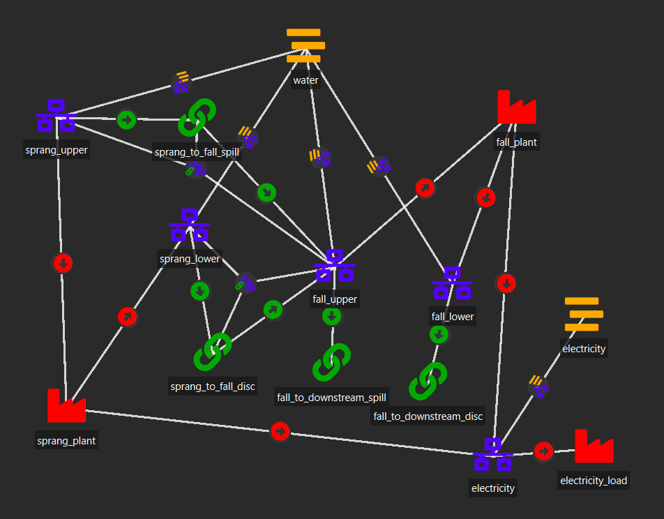
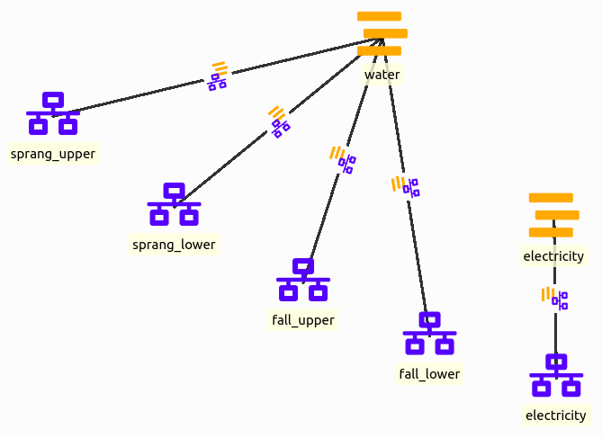
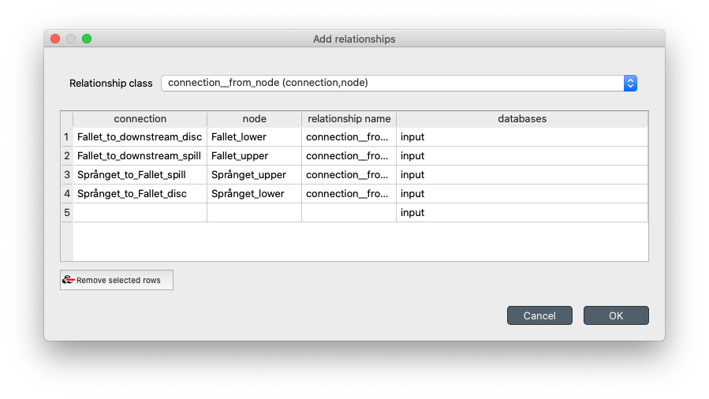
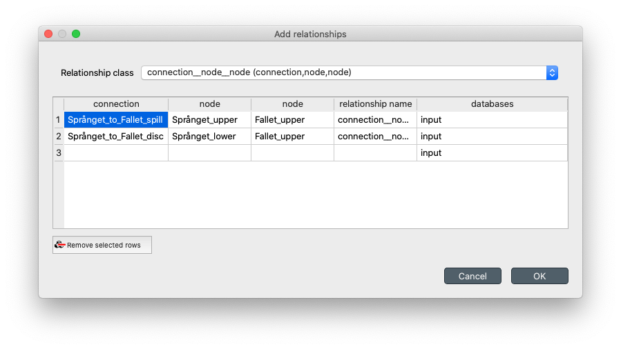
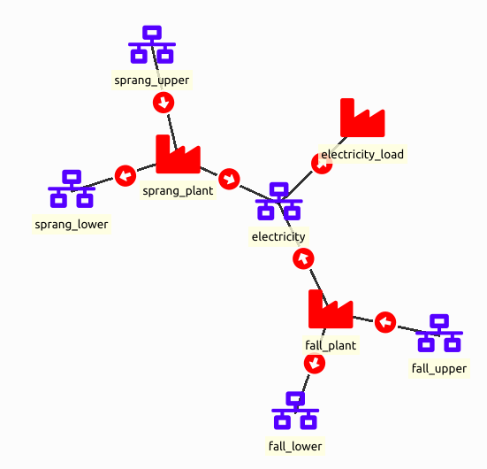

# How to model hydropower coupling

This how-to aims at demonstrating how we can model a hydropower system
in Spine (*SpineOpt.jl* and *Spine-Toolbox*) with different assumptions and
goals. It starts off by setting up a simple model of system of two
hydropower plants and gradually introduces additional features.

!!! info
    In each of the next sections, we perform incremental changes to the
    initial simple hydropower model. If you want to keep the database that
    you created, you can duplicate the database file (right-click on the
    input database and select **Duplicate and duplicate files**) and perform
    the changes in the new database. You need to configure the workflow
    accordingly in order to run the database you want (please check the
    Simple System tutorial for how to do that).

## Context

The goal of the model is to capture the combined operation of two hydropower
plants (Språnget and Fallet) that operate on the same river as shown in
the picture bellow. Each power plant has its own reservoir and generates
electricity by discharging water. The plants might need to spill water,
i.e., release water from their reservoirs without generating
electricity, for various reasons. The water discharged or spilled by the
upstream power plant follows the river route and becomes available to
the downstream power plant.

## Setting up a basic hydropower model

The picture below shows how such a system of hydropower plants translates to a SpineOpt model.
It looks quite daunting at first glance, but we'll break it down in smaller parts in the following subsections.

The model of this section is available as the example file [hydro\_power\_coupling.json](https://github.com/spine-tools/SpineOpt.jl/blob/master/examples/hydro_power_coupling.json). You can import it into an empty input database to compare it with the steps below.

### Starting point

1. Create a workflow in Spine Toolbox with an input database, a Run SpineOpt tool and an output database, as on the [Verify installation](@ref recommended_workflow) page.
2. Double-click the input database to open it in the Spine DB editor.
3. Select **File > Import...** and import [the SpineOpt database template](https://raw.githubusercontent.com/spine-tools/SpineOpt.jl/master/templates/spineopt_template.json) (right-click the link and select *Save link as...* to download it first).
4. In the same way, import [the basic SpineOpt model](https://raw.githubusercontent.com/spine-tools/SpineOpt.jl/master/templates/models/basic_model_template.json). It contains the model `simple`, the temporal block `flat`, the deterministic stochastic structure and the report `report1`.
5. Press **Commit** in the toolbar.

In the steps below, enter all values in the Parameter value table with the alternative `Base`. For values marked *(drop-down)*, double-click the value cell and pick the value from the drop-down list. For values marked with a type, such as *(Duration)*, right-click the value cell, select **Edit...** and choose that parameter type.

!!! note
    In the Parameter value table, the first row is a filter row. Enter new values on the empty row below it.

### Model

Before we can create the hydropower system, we'll have to define a model, temporal structure and stochastic structure. The basic model in the templates will do. Though, we'll change the temporal resolution to 6h and the model start / end to for 1 day as an example.

As for the report, we are typically interested in the outputs: [node\_state](@ref var_node_state), [unit\_flow](@ref var_unit_flow)s and [connection\_flow](@ref var_connection_flow)s.

1. Enter the following values:

| group | class | entity byname | parameter name | alternative | value |
|:---|:---|:---|:---|:---|:---|
| | model | simple | [model\_start](@ref) | Base | 2000-01-01T00:00:00 *(Date time)* |
| | model | simple | [model\_end](@ref) | Base | 2000-01-02T00:00:00 *(Date time)* |
| | temporal\_block | flat | [resolution](@ref) | Base | 6h *(Duration)* |

2. Right-click the [report\_\_output](@ref) class, select **Add entities...**, add `report1 | node_state`, `report1 | unit_flow` and `report1 | connection_flow` and press **OK**.
3. Press **Commit**.

### Nodes and grids

Nodes are at the center of a SpineOpt system, so let's start with that. There are other ways to model hydropower plants but here we represent each hydropower plant with 2 nodes, an 'upper' node to represent the water arriving at each plant and a 'lower' node to represent the water that is discharged and becomes available to the next plant. The general idea of splitting these in 2 nodes is to be able to simulate a time delay between the entrance and the exit (although in this tutorial we will not go in detail in this time delay).

Additionally we need a node for electricity.

Optionally, we can indicate that we are dealing with water flows and electricity production through [grid](@ref)s. Note that grids are only indicative and are not strictly necessary. As in the picture below, we define a `water` and an `electricity` [grid](@ref), and we connect these to the [node](@ref)s with [node\_\_grid](@ref) entities.

1. Right-click the [node](@ref) class, select **Add entities...**, add `sprang_upper`, `sprang_lower`, `fall_upper`, `fall_lower` and `electricity` and press **OK**.
2. Right-click the [grid](@ref) class and add `water` and `electricity` in the same way.
3. Right-click the [node\_\_grid](@ref) class and add `sprang_upper | water`, `sprang_lower | water`, `fall_upper | water`, `fall_lower | water` and `electricity | electricity`.

### Flows by means of connections

We'll ensure a correct flow between the nodes through [connection](@ref)s. The flows include:
+ local inflows in the reservoirs,
+ internal flows in the hydropower plants (between the 'upper' and 'lower' nodes),
+ the discharge flow that exits the Språnget hydropower plant at the lower node and flows to the upper node of the Fallet hydropower plant,
+ the spill flow that bypasses the Språnget hydropower plant at the upper node and flows to the upper node of the Fallet hydropower plant,
+ the discharge flow that exits the Fallet hydropower plant at the lower node and flows to the downstream river,
+ the spill flow that bypasses the Fallet hydropower plant at the upper node and flows to the downstream river.

For the local inflows in the reservoirs, we actually do not need a connection. Instead, we can model this as a negative demand in one of the nodes of the power plant. Here we use an inflow of 112 for Språnget and 2 for Fallet:

| group | class | entity byname | parameter name | alternative | value |
|:---|:---|:---|:---|:---|:---|
| | node | sprang\_upper | [demand](@ref) | Base | -112.0 |
| | node | fall\_upper | [demand](@ref) | Base | -2.0 |

The flow within each hydropower plant, i.e. the discharge flow between the 'upper' and the 'lower' node to generate the electricity, will also not be handled by the connection but by the units. In fact, anything that happens between the 'upper' and 'lower' nodes will be handled by the units.

For each of the remaining flows we create a [connection](@ref) entity. These [connection](@ref)s need to be connected to [node](@ref)s to function properly. To that end we'll use the [connection\_\_from\_node](@ref). As the name suggests, we connect the connection to the node where the flow comes from, e.g. the 'lower' node of the Språnget hydropower plant to the connection between the 'lower' node of the Språnget and the 'upper' node of the Fallet hydropower plant.

The two connections that bring water to the Fallet hydropower plant also need a [connection\_\_to\_node](@ref) to the 'upper' node of the Fallet hydropower plant. Without it, the water from Språnget leaves the model instead of reaching Fallet. The two connections to the downstream river only need the [connection\_\_from\_node](@ref), as the water leaves the modelled system there.

As the flows are unbound by default, we also need to define the relation between the nodes and the flows with the [connection\_\_node\_\_node](@ref) entities. We need one between the 'upper' node of the Språnget hydropower plant and the 'upper' node of the Fallet hydropower plant for the corresponding spill connection. We also need one between the 'lower' node of the Språnget hydropower plant and the 'upper' node of the Fallet hydropower plant for the corresponding discharge connection. We bind the flows by setting the [fix\_ratio\_out\_in\_connection\_flow](@ref) to 1.0, i.e. all the water that enters the connection also leaves it.

1. Enter the inflows above.
2. Right-click the [connection](@ref) class and add `sprang_to_fall_spill`, `sprang_to_fall_disc`, `fall_to_downstream_spill` and `fall_to_downstream_disc`.
3. Right-click the [connection\_\_from\_node](@ref) class and add `sprang_to_fall_spill | sprang_upper`, `sprang_to_fall_disc | sprang_lower`, `fall_to_downstream_spill | fall_upper` and `fall_to_downstream_disc | fall_lower`.

4. Right-click the [connection\_\_to\_node](@ref) class and add `sprang_to_fall_spill | fall_upper` and `sprang_to_fall_disc | fall_upper`.
5. Right-click the [connection\_\_node\_\_node](@ref) class and add `sprang_to_fall_spill | fall_upper | sprang_upper` and `sprang_to_fall_disc | fall_upper | sprang_lower`. The first node is the one where the flow goes and the second the one where it comes from.

6. Enter the following values and press **Commit**:

| group | class | entity byname | parameter name | alternative | value |
|:---|:---|:---|:---|:---|:---|
| | connection\_\_node\_\_node | sprang\_to\_fall\_disc ǀ fall\_upper ǀ sprang\_lower | [fix\_ratio\_out\_in\_connection\_flow](@ref) | Base | 1.0 |
| | connection\_\_node\_\_node | sprang\_to\_fall\_spill ǀ fall\_upper ǀ sprang\_upper | [fix\_ratio\_out\_in\_connection\_flow](@ref) | Base | 1.0 |

### Energy conversion by means of units

Each hydropower plant uses a [unit](@ref) to convert the flow of water to electricity. These units are connected to the 'upper' and 'lower' nodes of the hydropower plants and the 'electricity' node. Water enters the 'upper' node, so the 'upper' node is connected to the unit through the [node\_\_to\_unit](@ref). Water is then discharged, so the 'lower' node is connected to the unit through the [unit\_\_to\_node](@ref). As the water discharges, electricity is produced, so the 'electricity' node is also connected to the unit through the [unit\_\_to\_node](@ref).

Additionally, we add a unit to represent the income from selling the electricity production in the electricity market. The electricity price will be represented by a negative variable operation and maintenance (VOM) cost on the [node\_\_to\_unit](@ref) between the electricity node and the unit.

1. Right-click the [unit](@ref) class and add `sprang_plant`, `fall_plant` and `electricity_load`.
2. Right-click the [node\_\_to\_unit](@ref) class and add `sprang_upper | sprang_plant`, `fall_upper | fall_plant` and `electricity | electricity_load`.
3. Right-click the [unit\_\_to\_node](@ref) class and add `sprang_plant | sprang_lower`, `sprang_plant | electricity`, `fall_plant | fall_lower` and `fall_plant | electricity`.

Again, by default the flows are unbound, so we have to bind them with [unit\_flow\_\_unit\_flow](@ref) entities. The discharge flow from the 'upper' node flows in its entirety to the 'lower' node, so the [flow\_ratio\_equality\_coefficient](@ref) between the 'lower' and the 'upper' node is 1.0. For the conversion from water flow to electricity, we need to take the conversion efficiency of the plant into account: the [flow\_ratio\_equality\_coefficient](@ref) between the 'electricity' and the 'upper' node is 0.6 for the Språnget hydropower plant and 0.68 for the Fallet hydropower plant.

4. Right-click the [unit\_flow\_\_unit\_flow](@ref) class, select **Add entities...** and choose the unit, its output flow and its input flow, resulting in `sprang_plant | sprang_lower | sprang_upper | sprang_plant`, `sprang_plant | electricity | sprang_upper | sprang_plant`, `fall_plant | fall_lower | fall_upper | fall_plant` and `fall_plant | electricity | fall_upper | fall_plant`.
5. Enter the following values and press **Commit**. The capacities limit the water flow into the units and the electricity production.

| group | class | entity byname | parameter name | alternative | value |
|:---|:---|:---|:---|:---|:---|
| | node\_\_to\_unit | sprang\_upper ǀ sprang\_plant | [capacity\_per\_unit](@ref) | Base | 115.0 |
| | node\_\_to\_unit | fall\_upper ǀ fall\_plant | [capacity\_per\_unit](@ref) | Base | 165.0 |
| | node\_\_to\_unit | electricity ǀ electricity\_load | [vom\_cost](@ref) | Base | see below *(Time series fixed resolution)* |
| | unit\_\_to\_node | sprang\_plant ǀ electricity | [capacity\_per\_unit](@ref) | Base | 69.0 |
| | unit\_\_to\_node | fall\_plant ǀ electricity | [capacity\_per\_unit](@ref) | Base | 112.2 |
| | unit\_flow\_\_unit\_flow | sprang\_plant ǀ sprang\_lower ǀ sprang\_upper ǀ sprang\_plant | [flow\_ratio\_equality\_coefficient](@ref) | Base | 1.0 |
| | unit\_flow\_\_unit\_flow | sprang\_plant ǀ electricity ǀ sprang\_upper ǀ sprang\_plant | [flow\_ratio\_equality\_coefficient](@ref) | Base | 0.6 |
| | unit\_flow\_\_unit\_flow | fall\_plant ǀ fall\_lower ǀ fall\_upper ǀ fall\_plant | [flow\_ratio\_equality\_coefficient](@ref) | Base | 1.0 |
| | unit\_flow\_\_unit\_flow | fall\_plant ǀ electricity ǀ fall\_upper ǀ fall\_plant | [flow\_ratio\_equality\_coefficient](@ref) | Base | 0.68 |

For the electricity price, set the start time to `2000-01-01T00:00:00` and the resolution to `6h` in the *Edit value* dialog, and enter the following values. Any (negative) values are fine, but these give the results shown at the end of this section.

| t | value |
|:---|---:|
| 2000-01-01T00:00:00 | -325.0 |
| 2000-01-01T06:00:00 | -250.0 |
| 2000-01-01T12:00:00 | -425.0 |
| 2000-01-01T18:00:00 | -400.0 |

### Storage in nodes

To model the reservoirs of each hydropower plant, we leverage the [node\_state](@ref var_node_state) variable to represent storage capability. We only need to do this for one of the two nodes that we have used to model each plant and we choose the *upper* level node. To activate the storage functionality of a node, we set the value of the parameter [storage\_active](@ref) as `true`. Then, we need to set the capacity of the reservoir by setting the [storage\_state\_max](@ref) parameter value.

Depending on the constraints of your hydropower plant, you can also fix the initial and final values of the reservoir by setting the parameter [storage\_state\_fix](@ref) to the respective values (use `nan` values for the time steps that you don't want to impose such constraints). When fixing the initial value of a reservoir value, the value should be fixed at ‘t-1’ instead of ’t0’. That is because the initial value of a reservoir means the previous value before the first hour. With the 6h resolution, the initial value is therefore set at `1999-12-31T18:00:00`, one time step before the [model\_start](@ref), and the final value at `2000-01-01T18:00:00`, the start of the last time step.

1. Enter the following values:

| group | class | entity byname | parameter name | alternative | value |
|:---|:---|:---|:---|:---|:---|
| | node | sprang\_upper | [storage\_active](@ref) | Base | true |
| | node | sprang\_upper | [storage\_state\_max](@ref) | Base | 3600.0 |
| | node | sprang\_upper | [storage\_state\_fix](@ref) | Base | see below *(Time series variable resolution)* |
| | node | fall\_upper | [storage\_active](@ref) | Base | true |
| | node | fall\_upper | [storage\_state\_max](@ref) | Base | 3900.0 |
| | node | fall\_upper | [storage\_state\_fix](@ref) | Base | see below *(Time series variable resolution)* |

2. For [storage\_state\_fix](@ref), enter the following rows in the *Edit value* dialog:

| t | sprang\_upper | fall\_upper |
|:---|---:|---:|
| 1999-12-31T18:00:00 | 1000.0 | 1200.0 |
| 2000-01-01T00:00:00 | nan | nan |
| 2000-01-01T06:00:00 | nan | nan |
| 2000-01-01T12:00:00 | nan | nan |
| 2000-01-01T18:00:00 | 1722.27 | 768.0 |

3. Press **Commit**.

### Examining the results

At this point the model should be ready to run.

1. Run the SpineOpt tool.
2. Double-click the output database to open it in the Spine DB editor.
3. Press the **Index** button in the toolbar to show the results in a pivot table.
4. In the Entity tree, select `report__unit__node__direction__stochastic_scenario` for the [unit\_flow](@ref var_unit_flow) results.
5. Under alternative in the *Frozen table*, pick the latest run ("Run SpineOpt@..."). Each run is saved as its own alternative.

You should get the following [unit\_flow](@ref var_unit_flow) results. The *from\_node* flows of the plants are the water they discharge, the *to\_node* flows to *electricity* their electricity production, and the flow from *electricity* to *electricity\_load* the total electricity production.

| report | unit | node | direction | stochastic\_scenario | index | unit\_flow |
|:---|:---|:---|:---|:---|:---|---:|
| report1 | electricity\_load | electricity | from\_node | realization | 2000-01-01T00:00:00 | 111.36 |
| report1 | electricity\_load | electricity | from\_node | realization | 2000-01-01T06:00:00 | 0 |
| report1 | electricity\_load | electricity | from\_node | realization | 2000-01-01T12:00:00 | 181.2 |
| report1 | electricity\_load | electricity | from\_node | realization | 2000-01-01T18:00:00 | 181.2 |
| report1 | fall\_plant | electricity | to\_node | realization | 2000-01-01T00:00:00 | 52.78 |
| report1 | fall\_plant | electricity | to\_node | realization | 2000-01-01T06:00:00 | 0 |
| report1 | fall\_plant | electricity | to\_node | realization | 2000-01-01T12:00:00 | 112.2 |
| report1 | fall\_plant | electricity | to\_node | realization | 2000-01-01T18:00:00 | 112.2 |
| report1 | fall\_plant | fall\_lower | to\_node | realization | 2000-01-01T00:00:00 | 77.62 |
| report1 | fall\_plant | fall\_lower | to\_node | realization | 2000-01-01T06:00:00 | 0 |
| report1 | fall\_plant | fall\_lower | to\_node | realization | 2000-01-01T12:00:00 | 165 |
| report1 | fall\_plant | fall\_lower | to\_node | realization | 2000-01-01T18:00:00 | 165 |
| report1 | fall\_plant | fall\_upper | from\_node | realization | 2000-01-01T00:00:00 | 77.62 |
| report1 | fall\_plant | fall\_upper | from\_node | realization | 2000-01-01T06:00:00 | 0 |
| report1 | fall\_plant | fall\_upper | from\_node | realization | 2000-01-01T12:00:00 | 165 |
| report1 | fall\_plant | fall\_upper | from\_node | realization | 2000-01-01T18:00:00 | 165 |
| report1 | sprang\_plant | electricity | to\_node | realization | 2000-01-01T00:00:00 | 58.57 |
| report1 | sprang\_plant | electricity | to\_node | realization | 2000-01-01T06:00:00 | 0 |
| report1 | sprang\_plant | electricity | to\_node | realization | 2000-01-01T12:00:00 | 69 |
| report1 | sprang\_plant | electricity | to\_node | realization | 2000-01-01T18:00:00 | 69 |
| report1 | sprang\_plant | sprang\_lower | to\_node | realization | 2000-01-01T00:00:00 | 97.62 |
| report1 | sprang\_plant | sprang\_lower | to\_node | realization | 2000-01-01T06:00:00 | 0 |
| report1 | sprang\_plant | sprang\_lower | to\_node | realization | 2000-01-01T12:00:00 | 115 |
| report1 | sprang\_plant | sprang\_lower | to\_node | realization | 2000-01-01T18:00:00 | 115 |
| report1 | sprang\_plant | sprang\_upper | from\_node | realization | 2000-01-01T00:00:00 | 97.62 |
| report1 | sprang\_plant | sprang\_upper | from\_node | realization | 2000-01-01T06:00:00 | 0 |
| report1 | sprang\_plant | sprang\_upper | from\_node | realization | 2000-01-01T12:00:00 | 115 |
| report1 | sprang\_plant | sprang\_upper | from\_node | realization | 2000-01-01T18:00:00 | 115 |

For the reservoir levels, select `report__node__stochastic_scenario` in the Entity tree. You should get the following [node\_state](@ref var_node_state) results:

| report | node | stochastic\_scenario | index | node\_state |
|:---|:---|:---|:---|---:|
| report1 | fall\_upper | realization | 2000-01-01T00:00:00 | 1332 |
| report1 | fall\_upper | realization | 2000-01-01T06:00:00 | 1344 |
| report1 | fall\_upper | realization | 2000-01-01T12:00:00 | 1056 |
| report1 | fall\_upper | realization | 2000-01-01T18:00:00 | 768 |
| report1 | sprang\_upper | realization | 2000-01-01T00:00:00 | 1086.27 |
| report1 | sprang\_upper | realization | 2000-01-01T06:00:00 | 1758.27 |
| report1 | sprang\_upper | realization | 2000-01-01T12:00:00 | 1740.27 |
| report1 | sprang\_upper | realization | 2000-01-01T18:00:00 | 1722.27 |

The plants produce at full capacity in the two most expensive time steps (prices 425 and 400) and save water in the cheapest one (price 250). The rest of the water is used in the first time step so that the reservoirs reach their fixed final values. The [connection\_flow](@ref var_connection_flow) results show the same water flows between the plants and to the downstream river.

## Maximisation of Stored Water

Instead of fixing the water content of the reservoirs at the end of the
planning period, we can consider that the remaining water in the
reservoirs has a value and then maximize the value along with the
revenues for producing electricity within the planning horizon. This
objective term is often called the **Value of stored water** and we can
approximate it by assuming that this water will be used to generate
electricity in the future that would be sold at a forecasted price. The
water stored in the upstream hydropower plant will become also available
to the downstream plant and this should be taken into account.

### Changes to the basic model

Start from the basic model of the previous section. If you want to keep it, duplicate the database first, as explained at the top of this page.

1. Right-click the [node](@ref) class and add `stored_water`. This node will accumulate the water stored in the reservoirs at the end of the planning horizon.
2. Right-click the [node\_\_grid](@ref) class and add `stored_water | water`.
3. Right-click the [unit](@ref) class and add `sprang_stored_water`, `fall_stored_water` and `value_stored_water`. The first two transfer the water left in the reservoirs to the *stored\_water* node, and the third one is a *sink* that introduces the value of stored water in the objective function.
4. Right-click the [node\_\_to\_unit](@ref) class and add `stored_water | value_stored_water`, `sprang_upper | sprang_stored_water` and `fall_upper | fall_stored_water`.
5. Right-click the [unit\_\_to\_node](@ref) class and add `sprang_stored_water | stored_water` and `fall_stored_water | stored_water`.
6. Right-click the [unit\_flow\_\_unit\_flow](@ref) class and add `sprang_stored_water | stored_water | sprang_upper | sprang_stored_water` and `fall_stored_water | stored_water | fall_upper | fall_stored_water`.
7. Extend the planning horizon of the model by one time step: change the [model\_end](@ref) to `2000-01-02T06:00:00`.
8. Remove the final values of the reservoirs: open the [storage\_state\_fix](@ref) of *sprang\_upper* and *fall\_upper* with **Edit...**, select the last row (`2000-01-01T18:00:00`), right-click, select **Remove rows** and press **OK**. The initial values stay.
9. Open the [vom\_cost](@ref) of *electricity ǀ electricity\_load* with **Edit...** and add a fifth value, 0.0, for the extra time step. The price is set to zero to ensure no electricity is sold during this time step.
10. Enter the following values and press **Commit**:

| group | class | entity byname | parameter name | alternative | value |
|:---|:---|:---|:---|:---|:---|
| | node\_\_to\_unit | stored\_water ǀ value\_stored\_water | [vom\_cost](@ref) | Base | see below *(Time series fixed resolution)* |
| | unit\_flow\_\_unit\_flow | sprang\_stored\_water ǀ stored\_water ǀ sprang\_upper ǀ sprang\_stored\_water | [flow\_ratio\_equality\_coefficient](@ref) | Base | 1.28 |
| | unit\_flow\_\_unit\_flow | fall\_stored\_water ǀ stored\_water ǀ fall\_upper ǀ fall\_stored\_water | [flow\_ratio\_equality\_coefficient](@ref) | Base | 0.68 |

For the [vom\_cost](@ref) of *value\_stored\_water*, set the start time to `2000-01-01T00:00:00` and the resolution to `6h`. We impose a zero cost for the original planning horizon and use an assumed future electricity price for the extra time step at the end of the horizon:

| t | value |
|:---|---:|
| 2000-01-01T00:00:00 | 0.0 |
| 2000-01-01T06:00:00 | 0.0 |
| 2000-01-01T12:00:00 | 0.0 |
| 2000-01-01T18:00:00 | 0.0 |
| 2000-01-02T00:00:00 | -400.0 |

The efficiency of *fall\_stored\_water* is the same as that of *fall\_plant*, as the water in Fallet's reservoir will be used to produce electricity by the Fallet plant only. On the other hand, the water from Språnget's reservoir will be used both by the Språnget and the Fallet plant, therefore we use the sum of the two efficiencies (0.6 + 0.68 = 1.28) for *sprang\_stored\_water*.

### Examining the results

The model of this section is available as the example file [hydro\_power\_coupling\_stored\_water.json](https://github.com/spine-tools/SpineOpt.jl/blob/master/examples/hydro_power_coupling_stored_water.json). Run the model and open the results as in the basic model. You should get the following [unit\_flow](@ref var_unit_flow) results for the first three time steps. To show only these rows, select only `electricity_load`, `fall_plant` and `sprang_plant` in the *unit* column header and only `from_node` in the *direction* column header:

| report | unit | node | direction | stochastic\_scenario | index | unit\_flow |
|:---|:---|:---|:---|:---|:---|---:|
| report1 | electricity\_load | electricity | from\_node | realization | 2000-01-01T00:00:00 | 0 |
| report1 | electricity\_load | electricity | from\_node | realization | 2000-01-01T06:00:00 | 0 |
| report1 | electricity\_load | electricity | from\_node | realization | 2000-01-01T12:00:00 | 181.2 |
| report1 | fall\_plant | fall\_upper | from\_node | realization | 2000-01-01T00:00:00 | 0 |
| report1 | fall\_plant | fall\_upper | from\_node | realization | 2000-01-01T06:00:00 | 0 |
| report1 | fall\_plant | fall\_upper | from\_node | realization | 2000-01-01T12:00:00 | 165 |
| report1 | sprang\_plant | sprang\_upper | from\_node | realization | 2000-01-01T00:00:00 | 0 |
| report1 | sprang\_plant | sprang\_upper | from\_node | realization | 2000-01-01T06:00:00 | 0 |
| report1 | sprang\_plant | sprang\_upper | from\_node | realization | 2000-01-01T12:00:00 | 115 |

And the following [node\_state](@ref var_node_state) results:

| report | node | stochastic\_scenario | index | node\_state |
|:---|:---|:---|:---|---:|
| report1 | fall\_upper | realization | 2000-01-01T00:00:00 | 1212 |
| report1 | fall\_upper | realization | 2000-01-01T06:00:00 | 1224 |
| report1 | fall\_upper | realization | 2000-01-01T12:00:00 | 936 |
| report1 | fall\_upper | realization | 2000-01-02T00:00:00 | 0 |
| report1 | sprang\_upper | realization | 2000-01-01T00:00:00 | 1672 |
| report1 | sprang\_upper | realization | 2000-01-01T06:00:00 | 2344 |
| report1 | sprang\_upper | realization | 2000-01-01T12:00:00 | 2326 |
| report1 | sprang\_upper | realization | 2000-01-02T00:00:00 | 0 |

The plants no longer produce in the first two time steps, as the stored water is worth more than the electricity sold at the prices 325 and 250. For example, water stored in Språnget is valued at 1.28 × 400 = 512, as it can later be used by both plants. In the extra time step, all the remaining water is moved to the *stored\_water* node and the reservoirs are emptied.

The results of 18:00 are left out of the tables on purpose. At 18:00, the electricity price (400) is equal to the assumed future electricity price, so selling and storing the water give the same value. Therefore, the split between production at 18:00 and stored water can differ between runs, while the objective value stays the same.

As an exercise, try to retrieve the value of stored water as it is calculated by the model.

## Spillage Constraints - Minimisation of Spilt Water

It might be the case that we need to impose certain limits to the amount
of water that is spilt on each time step of the planning horizon, e.g.,
for environmental reasons, there can be a minimum and a maximum spillage
level. At the same time, to avoid wasting water that could be used for
producing electricity, we could explicitly impose the spillage
minimisation to be added in the objective function.

### Changes to the basic model

Start from the basic model, not from the stored water model. If you want to keep it, duplicate the database first, as explained at the top of this page. Here we replace the spill connection of Språnget with a unit, *sprang\_spill*, which can limit and penalise the spilt water.

1. In the Entity tree, expand the [connection](@ref) class, right-click `sprang_to_fall_spill` and select **Remove...**. Its [connection\_\_from\_node](@ref), [connection\_\_to\_node](@ref) and [connection\_\_node\_\_node](@ref) entities are removed with it.
2. Right-click the [unit](@ref) class and add `sprang_spill`.
3. Right-click the [node\_\_to\_unit](@ref) class and add `sprang_upper | sprang_spill`.
4. Right-click the [unit\_\_to\_node](@ref) class and add `sprang_spill | fall_upper`.
5. Right-click the [unit\_flow\_\_unit\_flow](@ref) class and add `sprang_spill | fall_upper | sprang_upper | sprang_spill`.
6. Enter the following values and press **Commit**:

| group | class | entity byname | parameter name | alternative | value |
|:---|:---|:---|:---|:---|:---|
| | node\_\_to\_unit | sprang\_upper ǀ sprang\_spill | [capacity\_per\_unit](@ref) | Base | 1000.0 |
| | node\_\_to\_unit | sprang\_upper ǀ sprang\_spill | [minimum\_operating\_point](@ref) | Base | 0.001 |
| | node\_\_to\_unit | sprang\_upper ǀ sprang\_spill | [vom\_cost](@ref) | Base | 1000.0 |
| | unit | sprang\_spill | [online\_variable\_type](@ref) | Base | none *(drop-down)* |
| | unit\_flow\_\_unit\_flow | sprang\_spill ǀ fall\_upper ǀ sprang\_upper ǀ sprang\_spill | [flow\_ratio\_equality\_coefficient](@ref) | Base | 1.0 |

What the values do:
- [capacity\_per\_unit](@ref) 1000: the maximum spillage.
- [minimum\_operating\_point](@ref) 0.001: the minimum spillage as a fraction of the capacity, i.e. 0.001 × 1000 = 1.
- [vom\_cost](@ref) 1000: a penalty for the spilt water, so that water is not spilt unnecessarily.
- [online\_variable\_type](@ref) `none`: the minimum operating point applies only when the unit is online. With the default type `linear`, the model can avoid the minimum spillage by taking the unit offline. With `none`, the unit is always online.
- [flow\_ratio\_equality\_coefficient](@ref) 1: all the spilt water reaches Fallet.

### Examining the results

The model of this section is available as the example file [hydro\_power\_coupling\_spillage.json](https://github.com/spine-tools/SpineOpt.jl/blob/master/examples/hydro_power_coupling_spillage.json). Run the model and open the results as in the basic model. You should get the following [unit\_flow](@ref var_unit_flow) results. To show only these rows, select only `electricity_load`, `sprang_plant` and `sprang_spill` in the *unit* column header. The results of *fall\_plant* are the same as in the basic model.

| report | unit | node | direction | stochastic\_scenario | index | unit\_flow |
|:---|:---|:---|:---|:---|:---|---:|
| report1 | electricity\_load | electricity | from\_node | realization | 2000-01-01T00:00:00 | 108.96 |
| report1 | electricity\_load | electricity | from\_node | realization | 2000-01-01T06:00:00 | 0 |
| report1 | electricity\_load | electricity | from\_node | realization | 2000-01-01T12:00:00 | 181.2 |
| report1 | electricity\_load | electricity | from\_node | realization | 2000-01-01T18:00:00 | 181.2 |
| report1 | sprang\_plant | electricity | to\_node | realization | 2000-01-01T00:00:00 | 56.17 |
| report1 | sprang\_plant | electricity | to\_node | realization | 2000-01-01T06:00:00 | 0 |
| report1 | sprang\_plant | electricity | to\_node | realization | 2000-01-01T12:00:00 | 69 |
| report1 | sprang\_plant | electricity | to\_node | realization | 2000-01-01T18:00:00 | 69 |
| report1 | sprang\_plant | sprang\_lower | to\_node | realization | 2000-01-01T00:00:00 | 93.62 |
| report1 | sprang\_plant | sprang\_lower | to\_node | realization | 2000-01-01T06:00:00 | 0 |
| report1 | sprang\_plant | sprang\_lower | to\_node | realization | 2000-01-01T12:00:00 | 115 |
| report1 | sprang\_plant | sprang\_lower | to\_node | realization | 2000-01-01T18:00:00 | 115 |
| report1 | sprang\_plant | sprang\_upper | from\_node | realization | 2000-01-01T00:00:00 | 93.62 |
| report1 | sprang\_plant | sprang\_upper | from\_node | realization | 2000-01-01T06:00:00 | 0 |
| report1 | sprang\_plant | sprang\_upper | from\_node | realization | 2000-01-01T12:00:00 | 115 |
| report1 | sprang\_plant | sprang\_upper | from\_node | realization | 2000-01-01T18:00:00 | 115 |
| report1 | sprang\_spill | fall\_upper | to\_node | realization | 2000-01-01T00:00:00 | 1 |
| report1 | sprang\_spill | fall\_upper | to\_node | realization | 2000-01-01T06:00:00 | 1 |
| report1 | sprang\_spill | fall\_upper | to\_node | realization | 2000-01-01T12:00:00 | 1 |
| report1 | sprang\_spill | fall\_upper | to\_node | realization | 2000-01-01T18:00:00 | 1 |
| report1 | sprang\_spill | sprang\_upper | from\_node | realization | 2000-01-01T00:00:00 | 1 |
| report1 | sprang\_spill | sprang\_upper | from\_node | realization | 2000-01-01T06:00:00 | 1 |
| report1 | sprang\_spill | sprang\_upper | from\_node | realization | 2000-01-01T12:00:00 | 1 |
| report1 | sprang\_spill | sprang\_upper | from\_node | realization | 2000-01-01T18:00:00 | 1 |

And the following [node\_state](@ref var_node_state) results:

| report | node | stochastic\_scenario | index | node\_state |
|:---|:---|:---|:---|---:|
| report1 | fall\_upper | realization | 2000-01-01T00:00:00 | 1314 |
| report1 | fall\_upper | realization | 2000-01-01T06:00:00 | 1332 |
| report1 | fall\_upper | realization | 2000-01-01T12:00:00 | 1050 |
| report1 | fall\_upper | realization | 2000-01-01T18:00:00 | 768 |
| report1 | sprang\_upper | realization | 2000-01-01T00:00:00 | 1104.27 |
| report1 | sprang\_upper | realization | 2000-01-01T06:00:00 | 1770.27 |
| report1 | sprang\_upper | realization | 2000-01-01T12:00:00 | 1746.27 |
| report1 | sprang\_upper | realization | 2000-01-01T18:00:00 | 1722.27 |

Due to the spillage penalty, the spillage stays at its minimum of 1. Compared with the basic model, Språnget discharges less in the first time step (93.62 instead of 97.62), as the spilt water also reaches Fallet and the reservoirs still have to reach the same final values.

As an exercise, you can perform this process for the Fallet plant (you would also need to add another water node, downstream of Fallet).

## Follow Contracted Load Curve

It is often the case that a system of hydropower plants should follow a
given production profile. To model this in the given system, all we have
to do is set a demand in the form of a timeseries to the *electricity* node.
