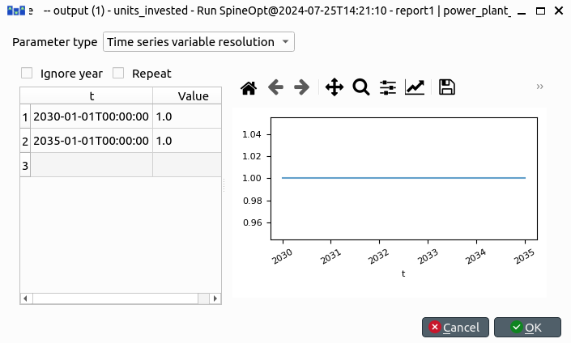
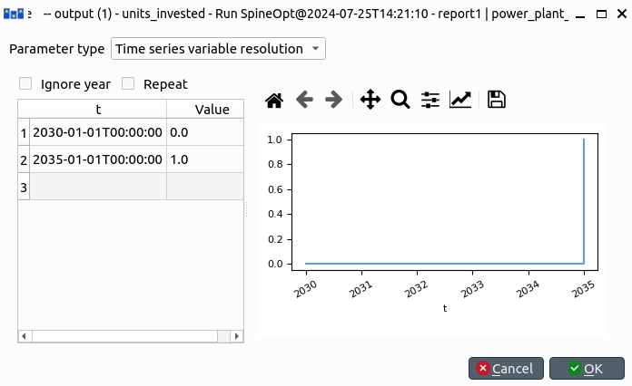
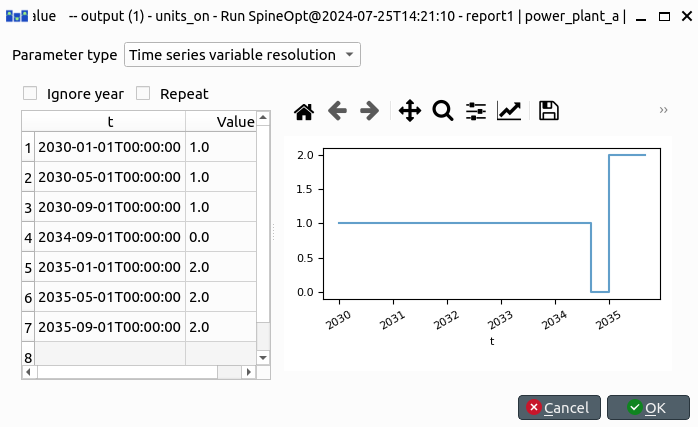
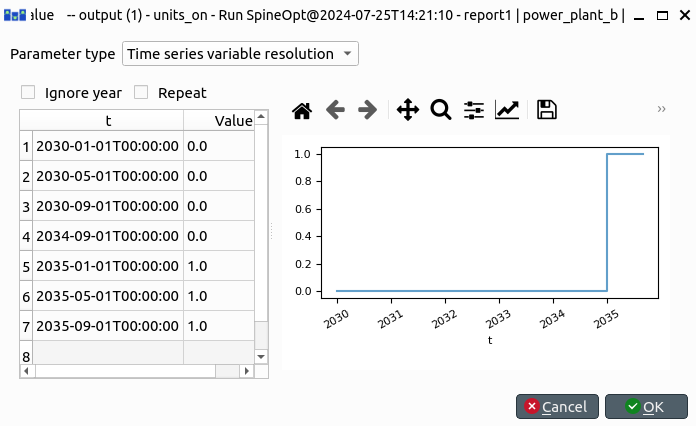

# Capacity Planning Tutorial

This tutorial provides a step-by-step guide to include investment constraints for capacity planning in a simple energy system with Spine Toolbox for SpineOpt. There is more information to be found in the documentation on [Investment Optimization](@ref). To get the most out of this tutorial, we suggest first completing the [Simple system tutorial](@ref).

## Overview

In this tutorial we will:
+ start from the simple system tutorial,
+ change the temporal structure from one day to seasons of four months (`4M`) over the years 2030-2035,
+ add a temporal block for investments,
+ and add investment related parameters for the units.

In the second part, we extend the model to multi-year investments, with investment decisions in both 2030 and 2035.

## Starting point

1. Create a workflow in Spine Toolbox with an input database, a Run SpineOpt tool and an output database, as on the [Verify installation](@ref recommended_workflow) page.
2. Double-click the input database to open it in the Spine DB editor.
3. Select **File > Import...** and import the [simple system example file](https://github.com/spine-tools/SpineOpt.jl/blob/master/examples/simple_system.json).
4. Press **Commit** in the toolbar.

In the steps below, enter all values in the Parameter value table with the alternative `Base`. For values marked *(drop-down)*, double-click the value cell and pick the value from the drop-down list. For values marked with a type, such as *(Duration)*, right-click the value cell, select **Edit...** and choose that parameter type.

!!! note
    In the Parameter value table, the first row is a filter row. Enter new values on the empty row below it.

## Temporal structure

For the investment optimization, we use a longer time horizon, 2030-2035. To keep the number of time steps small, the operation is modelled in seasons of four months (`4M`). Investments are decided in a separate temporal block with a resolution of five years (`5Y`), i.e. once in 2030 and once in 2035.

1. In the Entity tree, right-click the [temporal\_block](@ref) class and select **Add entities...**
2. Enter the name `investment` and press **OK**.
3. Right-click the [model\_\_default\_investment\_temporal\_block](@ref) class, select **Add entities...**, add `simple | investment` and press **OK**.
4. Right-click the [model\_\_default\_investment\_stochastic\_structure](@ref) class, select **Add entities...**, add `simple | deterministic` and press **OK**.
5. Enter or change the following values (values marked with * are changed from the simple system):

| group | class | entity byname | parameter name | alternative | value |
|:---|:---|:---|:---|:---|:---|
| | model | simple | [model\_end](@ref) | Base | 2036-01-01T00:00:00 * *(Date time)* |
| | model | simple | [model\_start](@ref) | Base | 2030-01-01T00:00:00 * *(Date time)* |
| | temporal\_block | flat | [resolution](@ref) | Base | 4M * *(Duration)* |
| | temporal\_block | investment | [resolution](@ref) | Base | 5Y *(Duration)* |

6. Press **Commit**.

!!! info
    Instead of a default connection to the model, the investment temporal block can also be made specific to a part of the energy system, e.g. with the [unit\_\_investment\_temporal\_block](@ref) entity.

## Unit investment parameters

Next, we make both power plants investment candidates. In the Entity tree, select the [unit](@ref) class and enter the following values:

| group | class | entity byname | parameter name | alternative | value |
|:---|:---|:---|:---|:---|:---|
| | unit | power\_plant\_a | [existing\_units](@ref) | Base | 0.0 |
| | unit | power\_plant\_a | [investment\_count\_initial\_cumulative](@ref) | Base | 0.0 |
| | unit | power\_plant\_a | [investment\_count\_max\_cumulative](@ref) | Base | 1.0 |
| | unit | power\_plant\_a | [investment\_variable\_type](@ref) | Base | integer *(drop-down)* |
| | unit | power\_plant\_a | [lifetime\_economic](@ref) | Base | 10Y *(Duration)* |
| | unit | power\_plant\_a | [lifetime\_technical](@ref) | Base | 10Y *(Duration)* |
| | unit | power\_plant\_a | [unit\_investment\_cost](@ref) | Base | 1000.0 |
| | unit | power\_plant\_a | [units\_on\_cost](@ref) | Base | 0.0 |
| | unit | power\_plant\_b | [existing\_units](@ref) | Base | 0.0 |
| | unit | power\_plant\_b | [investment\_count\_initial\_cumulative](@ref) | Base | 0.0 |
| | unit | power\_plant\_b | [investment\_count\_max\_cumulative](@ref) | Base | 1.0 |
| | unit | power\_plant\_b | [investment\_variable\_type](@ref) | Base | integer *(drop-down)* |
| | unit | power\_plant\_b | [lifetime\_economic](@ref) | Base | 10Y *(Duration)* |
| | unit | power\_plant\_b | [lifetime\_technical](@ref) | Base | 10Y *(Duration)* |
| | unit | power\_plant\_b | [unit\_investment\_cost](@ref) | Base | 1000.0 |
| | unit | power\_plant\_b | [units\_on\_cost](@ref) | Base | 0.0 |

What the values do:
- [existing\_units](@ref) 0 and [investment\_count\_initial\_cumulative](@ref) 0: the units do not exist unless the model invests in them.
- [investment\_count\_max\_cumulative](@ref) 1: the model can invest in at most one unit of each power plant.
- [investment\_variable\_type](@ref) `integer`: the investment is a whole number of units. With the default `linear`, the model would invest in 0.25 units of `power_plant_b`. The unit size comes from [capacity\_per\_unit](@ref) of the [unit\_\_to\_node](@ref) entity: 0.25 × 200 = 50, which is exactly the flow needed from `power_plant_b`.
- [lifetime\_technical](@ref) 10Y: a new unit must exist for at least 10 years after the investment. [lifetime\_economic](@ref) is used to adjust the investment cost; here it is equal to the technical lifetime.
- [unit\_investment\_cost](@ref) 1000: the cost of one new unit.
- [units\_on\_cost](@ref) 0: being online costs nothing.

!!! note
    Normally, you should use discounted investment costs: the costs in 2030 and 2035 are discounted to the discount year, e.g. with a time-varying cost.

!!! info
    Investments in storages and connections are very similar. Note that storages are modelled as nodes.

## Examine output

To see the investments in the results, add them to the report:

1. Right-click the [report\_\_output](@ref) class and select **Add entities...**
2. Add `report1 | units_invested` and `report1 | units_on` and press **OK** (see also [Managing output](@ref how-to-manage-output)).
3. Press **Commit** and run the SpineOpt tool.

Expected result for [units\_invested](@ref var_units_invested):

| unit | 2030 | 2035 |
|:---|:---|:---|
| power\_plant\_a | 1.0 | 0.0 |
| power\_plant\_b | 1.0 | 0.0 |

Both power plants are needed to cover the demand of 150 (100 + 50), so the model invests in one unit of each in 2030. In 2035, they still exist, so no new investments are needed.

The [units\_on](@ref var_units_on) values of `power_plant_b` may vary between 0.25 and 1.0. [units\_on](@ref var_units_on) is a continuous variable here and being online costs nothing, so any value large enough to cover the flow gives the same total cost.

## Multi-year investments tutorial

Multi-year investments refer to making investment decisions at different points in time, such that a pathway of investments can be modelled. This is useful when long-term scenarios are modelled, but modelling each year is not practical, or when investment decisions are made in different years, which affects the cash flow.

In this part, we consider two investment points: 2030 and 2035. The operation is modelled in seasons of four months, but only in 2030 and 2035. In other words, 2030 and 2035 are milestone years for the pathway 2030-2035. We continue from the model of the first part.

### Temporal structure

We replace the `flat` temporal block with two operation blocks, one for 2030 and one for 2035.

1. In the Entity tree, right-click the temporal block `flat` and select **Remove...**. If the old block is left in the model, the temporal structure will be wrong.
2. Right-click the [temporal\_block](@ref) class, select **Add entities...**, add `operation2030` and `operation2035` and press **OK**.
3. Right-click the [model\_\_default\_temporal\_block](@ref) class, select **Add entities...**, add `simple | operation2030` and `simple | operation2035` and press **OK**.
4. Enter the following values:

| group | class | entity byname | parameter name | alternative | value |
|:---|:---|:---|:---|:---|:---|
| | temporal\_block | investment | [resolution](@ref) | Base | 5Y * |
| | temporal\_block | operation2030 | [block\_end](@ref) | Base | 2031-01-01T00:00:00 *(Date time)* |
| | temporal\_block | operation2030 | [block\_start](@ref) | Base | 2030-01-01T00:00:00 *(Date time)* |
| | temporal\_block | operation2030 | [resolution](@ref) | Base | 4M *(Duration)* |
| | temporal\_block | operation2030 | [weight](@ref) | Base | 5.0 |
| | temporal\_block | operation2035 | [block\_end](@ref) | Base | 2036-01-01T00:00:00 *(Date time)* |
| | temporal\_block | operation2035 | [block\_start](@ref) | Base | 2034-09-01T00:00:00 *(Date time)* |
| | temporal\_block | operation2035 | [resolution](@ref) | Base | 4M *(Duration)* |
| | temporal\_block | operation2035 | [weight](@ref) | Base | 1.0 |

(* already set in the first part)

What the values do:
- [block\_start](@ref) and [block\_end](@ref) leave a gap between the years 2031 and 2034, which are not modelled.
- `operation2035` starts already in the last season of 2034 (2034-09-01). This extra time slice sets the boundary conditions for the block, see the info box below.
- [weight](@ref) 5 for `operation2030`: this block represents the operation in 2030-2034, so its operating costs are multiplied by five. `operation2035` only represents 2035, so its weight is 1. Without weights, the operating costs in the input data would have to cover the whole period.

!!! info
    Discontinuous (or non-consecutive) time slices in SpineOpt need to be initialized in order for SpineOpt to correctly generate constraints. For the first time slice that is done through the initialization parameters as has been done before in the tutorials. For the other time slices, an additional preceding time slice is needed. The boundary conditions for, e.g., initial storage level or online status of units can be set in that preceding time slice.

    Note that we do not yet support linking the boundary conditions with the previous operation temporal block. This additional definition means that we will also have results for it, which is redundant and should be ignored when post-processing.

### Demand

We assume that the demand grows from 100 in 2030 to 400 in 2035. The demand changes from a constant to a time series:

1. Select the [node](@ref) class, right-click the [demand](@ref) value of `electricity_node` and select **Edit...**
2. Choose the parameter type *Time series variable resolution* and enter:

| t | value |
|:---|:---|
| 2030-01-01T00:00:00 | 100.0 |
| 2030-05-01T00:00:00 | 100.0 |
| 2030-09-01T00:00:00 | 100.0 |
| 2034-09-01T00:00:00 | 0.0 |
| 2035-01-01T00:00:00 | 400.0 |
| 2035-05-01T00:00:00 | 400.0 |
| 2035-09-01T00:00:00 | 400.0 |

The value 0 at 2034-09-01 is for the extra time slice that sets the boundary conditions of `operation2035`.

### Investment limits

We allow investments in `power_plant_a` in both 2030 and 2035, and in `power_plant_b` only in 2035. For that, [investment\_count\_max\_cumulative](@ref) becomes a time series:

1. Select the [unit](@ref) class, right-click the [investment\_count\_max\_cumulative](@ref) value of `power_plant_a` and select **Edit...**
2. Choose the parameter type *Time series variable resolution* and enter the values below. Do the same for `power_plant_b`.

| t | power\_plant\_a | power\_plant\_b |
|:---|:---|:---|
| 2030-01-01T00:00:00 | 1.0 | 0.0 |
| 2035-01-01T00:00:00 | 2.0 | 1.0 |

Note that the value is cumulative: it includes the units invested in earlier. For `power_plant_a`, 2.0 in 2035 means one more unit on top of the one from 2030, not two more.

3. Press **Commit** and run the SpineOpt tool.

### Results

Expected result for [units\_invested](@ref var_units_invested):

| unit | 2030 | 2035 |
|:---|:---|:---|
| power\_plant\_a | 1.0 | 1.0 |
| power\_plant\_b | 0.0 | 1.0 |

In 2030, one unit of `power_plant_a` covers the demand of 100. In 2035, the demand of 400 needs a second unit of `power_plant_a` (2 × 100) and one unit of `power_plant_b` (200).

The [units\_on](@ref var_units_on) results show one unit of `power_plant_a` online in 2030 and two in 2035, and one unit of `power_plant_b` online in 2035. The value 0 at 2034-09-01 is the redundant boundary time slice and can be ignored.

## Debugging

The input database at the end of this tutorial is available as the [capacity planning example file](https://github.com/spine-tools/SpineOpt.jl/blob/master/examples/capacity_planning.json). You can import it into an empty input database to compare it with your own.
