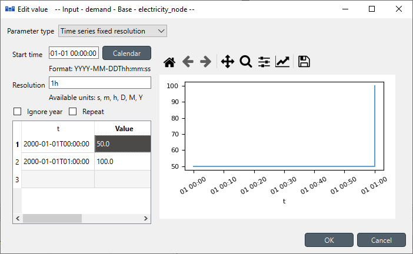
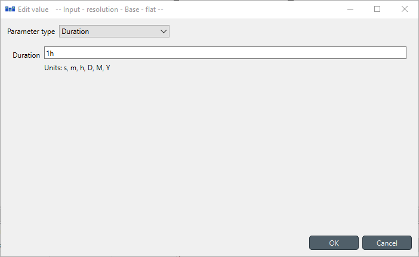
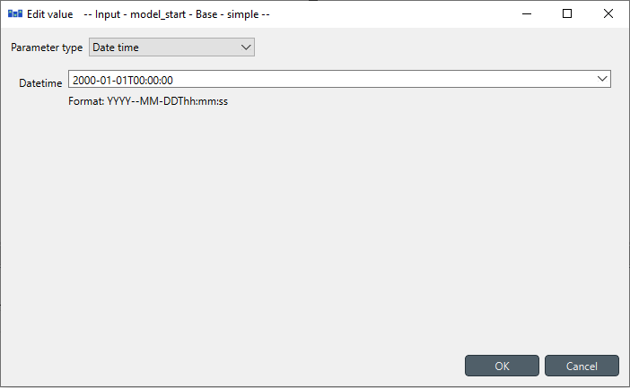
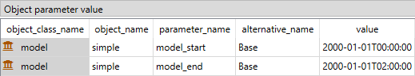
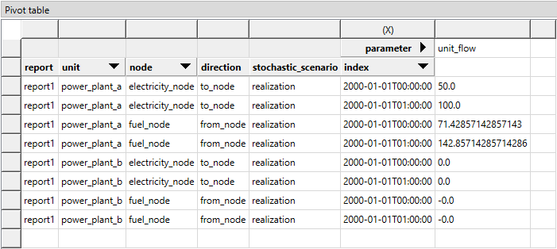
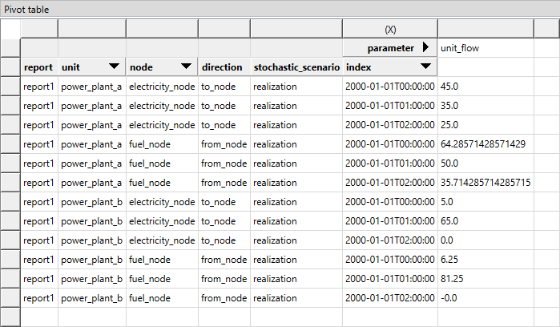

# Ramping definition tutorial

This tutorial provides a step-by-step guide to include ramping constraints in a simple energy system with Spine Toolbox for SpineOpt.

## Introduction

Welcome to our tutorial, where we will walk you through the process of adding ramping constraints in SpineOpt using Spine Toolbox. To get the most out of this tutorial, we suggest first completing the [Simple system tutorial](@ref).

The ramping constraint limit refers to the maximum rate at which a power unit can increase or decrease its output flow over time. These limits are typically put in place to prevent sudden and destabilizing shifts in power units. However, they may also represent any other physical limitations that a unit may have that is related to changes over time in its output flow.

### Model assumptions

This tutorial is built on top of the Simple System. The main changes to that system are:

- The demand at *electricity\_node* is a 3-hour time series instead of a unique value
- The *power\_plant\_a* has the following parameters:
  - Ramp limit of 10% for both up and down
  - Minimum operating point of 10% of its total capacity
  - Startup capacity limit of 10% of its total capacity
  - Shutdown capacity limit of 10% of its total capacity
  - Integer online variable, so the unit is either fully on or off

This tutorial includes a step-by-step guide to include the parameters to help analyze the results in SpineOpt and the ramping constraints concepts.

## Step 1 - Update the demand

### Opening the Simple System project

- Launch the Spine Toolbox and select **File** and then **Open project...** or use the keyboard shortcut **Ctrl + O** to open the desired project.
- Locate the folder that you saved in the Simple System tutorial and click *Ok*. This will prompt the Simple System workflow to appear in the *Design View* section for you to start working on.
- Double-click the 'input' Data Store item in the *Design View*. This will open the database in the *Spine DB editor*.

If you don't have the Simple System project, create a workflow as on the [Verify installation](@ref recommended_workflow) page and import the [simple system example file](https://github.com/spine-tools/SpineOpt.jl/blob/master/examples/simple_system.json) into the input database (File > Import...).

In this tutorial, you will learn how to add ramping constraints to the Simple System using the *Spine DB editor*, but first let's start by updating the electricity demand from a single value to a 3-hour time series.

### Editing demand value

- In the Spine DB editor, locate the *Entity tree* (typically at the top-left).
- Expand the [node](@ref) class, and select the *electricity\_node* from the expanded tree.
- Locate the *Parameter value* table (typically at the top-center).
- In the *Parameter value* table, identify the [demand](@ref) parameter which should have a 150 value from the Simple System first run.
- Right-click on the value cell and then select *edit* from the context menu. The *Edit value* dialog will pop up.
- Change the *Parameter type* to *Time series fixed resolution*, [resolution](@ref) to *1h*, and the demand values to 50, 100 and 25 starting from `2000-01-01T00:00:00`, as in the image below.
- Finish by pressing *OK* in the *Edit value* menu. In the *Parameter value* table you will see that the value of the [demand](@ref) has changed to *Time series*.

Notice that there are only demand values from `2000-01-01T00:00:00` to `2000-01-01T02:00:00`. Therefore, we need to update the start and end of the model. But first, let's change the temporal block.

### Editing the temporal block

You might or might not notice that the Simple System has, by default, a temporal block resolution of *1D* (i.e., one day); wait, what! Yes, by default, it has *1D* in its template. So, we want to change that to *1h* to make easy to follow the results.

- Locate again the *Entity tree* (typically at the top-left).
- Expand the [temporal\_block](@ref) class, and select the *flat* from the expanded tree.
- Locate the *Parameter value* table (typically at the top-center).
- In the *Parameter value* table, identify the [resolution](@ref) parameter which should have a *1D* value from the Simple System first run.
- Right-click on the value cell and then select *edit* from the context menu. The *Edit value* dialog will pop up.
- Change the *Duration* from *1D* to *1h* as shown in the image below.

### Editing the model start and end

Since the default resolution of the Simple System was *1D*, the start and end date of the model needs also to be changed.

- Locate again the *Entity tree* (typically at the top-left).
- Expand the [model](@ref) class, and select the *simple* from the expanded tree.
- Locate the *Parameter value* table (typically at the top-center).
- In the *Parameter value* table, select the [model\_start](@ref) parameter, the *Base* alternative, and then right-click on the value and select the *Edit* option in the context menu. Set the value to `2000-01-01T00:00:00`, as shown in the image below.

- Repeat the procedure for the [model\_end](@ref) parameter, but now the value is `2000-01-01T03:00:00`. The final values should look like that the image below.

> It's important to note that the model must finish in the third hour to account for all the periods of demand in input data, which goes until `2000-01-01T02:00:00`.

When you're ready, save/commit all changes to the database.

### Executing the workflow

- Go back to Spine Toolbox's main window, and hit the **Project** button in the *Execute* section of the toolbar. You should see 'Executing All Directed Acyclic Graphs' printed in the *Event log* (at the bottom left by default).

- Select the 'Run SpineOpt' Tool. You should see the output from SpineOpt in the *Julia Console*.

### Examining the results

- Select the output data store and open the Spine DB editor. You can already inspect the fields in the displayed tables or use a pivot table.

- For the pivot table, press the **Index** button in the toolbar.

- Select `report__unit__node__direction__stochastic_scenario` in the **Entity tree**.

- Under alternative in the *Frozen table*, you can choose results from different runs. By default the Frozen table shows the oldest run, so pick the latest run ("Run SpineOpt@...") yourself.

- The *Pivot table* will be populated with results from the SpineOpt run. It will look something like the image below.

The image above shows the electricity flow results for both power plants. As expected, the *power\_plant\_a* (i.e., the cheapest unit) always covers the demand in both hours, and then the *power\_plant\_b* (i.e., the more expensive unit) has zero production. This is the most economical dispatch since the problem has no extra constraints (so far!).

## Step 2 - Include the ramping limit

Let's consider the input data where the *power\_plant\_a* has a ramping limit of *10%* in both directions (i.e., up and down), meaning that the change between two time steps can't be greater than *10MW* (since the plant 'a' has a unit capacity of *100MW*). The [Ramping constraints](@ref) need the following parameters for their definition: minimum operating point, startup limit, and shutdown limit.

### Adding the new parameters

- In the *Entity tree*, expand the [unit\_\_to\_node](@ref) class and select *power\_plant\_a | electricity\_node*.

- In the *Parameter value* table (the ramping parameter names start with `ramp_limits_`):
  - Select the [ramp\_limits\_up](@ref) parameter and the *Base* alternative, and enter the value *0.1*. This will set the ramping up limit for *power\_plant\_a*.

  - Select the [ramp\_limits\_down](@ref) parameter and the *Base* alternative, and enter the value *0.1*. This will set the ramping down limit for *power\_plant\_a*.

  - Select the [minimum\_operating\_point](@ref) parameter and the *Base* alternative, and enter the value *0.1*. This will set the minimum operating point for *power\_plant\_a*.

  - Select the [ramp\_limits\_startup](@ref) parameter and the *Base* alternative, and enter the value *0.1*. This will set the startup capacity limit for *power\_plant\_a*.

  - Select the [ramp\_limits\_shutdown](@ref) parameter and the *Base* alternative, and enter the value *0.1*. This will set the shutdown capacity limit for *power\_plant\_a*.

In the Entity tree, expand [unit\_\_to\_node](@ref) and select *power\_plant\_a | electricity\_node*. The Parameter value table should show:

| group | class | entity byname | parameter name | alternative | value |
|:---|:---|:---|:---|:---|:---|
| | unit\_\_to\_node | power\_plant\_a ǀ electricity\_node | [capacity\_per\_unit](@ref) | Base | 100.0 |
| | unit\_\_to\_node | power\_plant\_a ǀ electricity\_node | [minimum\_operating\_point](@ref) | Base | 0.1 |
| | unit\_\_to\_node | power\_plant\_a ǀ electricity\_node | [ramp\_limits\_down](@ref) | Base | 0.1 |
| | unit\_\_to\_node | power\_plant\_a ǀ electricity\_node | [ramp\_limits\_shutdown](@ref) | Base | 0.1 |
| | unit\_\_to\_node | power\_plant\_a ǀ electricity\_node | [ramp\_limits\_startup](@ref) | Base | 0.1 |
| | unit\_\_to\_node | power\_plant\_a ǀ electricity\_node | [ramp\_limits\_up](@ref) | Base | 0.1 |

We also need to make the online status of *power\_plant\_a* an integer:

- In the *Entity tree*, expand the [unit](@ref) class and select *power\_plant\_a*.
- In the *Parameter value* table, select the [online\_variable\_type](@ref) parameter and the *Base* alternative, double-click the value cell and select *integer* from the drop-down list.

!!! note
    The ramping constraints depend on the online status of the unit ([units\_on](@ref var_units_on)). By default, [online\_variable\_type](@ref) is *linear*, which means that the unit can be partly online, e.g. 0.25. This allows the unit to partly shut down, which gives it extra room to ramp down, and the results would differ from the ones below (e.g. 48.75 MW instead of 45 MW in the first hour). With *integer*, the unit is either fully on or fully off.

When you're ready, save/commit all changes to the database.

### Executing the workflow with ramp limits

- Go back to Spine Toolbox's main window, and hit the **Project** button in the *Execute* section of the toolbar. You should see 'Executing All Directed Acyclic Graphs' printed in the *Event log* (at the bottom left by default).

- Select the 'Run SpineOpt' Tool. You should see the output from SpineOpt in the *Julia Console*.

### Examining the results with ramp limits

- Select the output data store and open the Spine DB editor. You can already inspect the fields in the displayed tables or use a pivot table.

- For the pivot table, press the **Index** button in the toolbar.

- Select `report__unit__node__direction__stochastic_scenario` in the **Entity tree**.

- Under alternative in the *Frozen table*, you can choose results from different runs. By default the Frozen table shows the oldest run, so pick the latest run ("Run SpineOpt@...") yourself.

- The *Pivot table* will be populated with results from the SpineOpt run. It will look something like the image below.

The image above shows the electricity flow results for both power plants. As expected, the *power\_plant\_a* (i.e., the cheapest unit) output is limited to its ramps limits, therefore it can't follow the demand changes as before. For instance, the unit's power output is 45MW in the first hour, which is lower than the previous result of 50MW in the same hour. This is because the unit needs to gradually decrease its power output and reach 25MW in the last hour. However, due to the imposed ramp-down limit of 10MW, it cannot start from 50MW as before. Therefore, the *power\_plant\_b* (i.e., the more expensive unit) must produce to cover the demand that plant 'a' can't due to its ramping limitations. As shown here, the ramping limits might lead to higher costs in power systems compared to the previous case.

*But...there is something more here...Can you tell what?* :anguished:

It is important to note that the optimal solution we have calculated assumes that the unit 'a' was already producing electricity before the [model\_start](@ref) parameter. This is because we have not defined an initial condition for the flow of the unit. Therefore, the flow at the first hour is the most cost-effective solution under this assumption. However, what if we changed this assumption and assumed that the unit had not produced any flow before the [model\_start](@ref) parameter? If you are curious to know the answer, join me in the next section.

## Step 3 - Include an initial condition to the flow

### Adding the initial flow

- In the *Entity tree*, expand the [unit\_\_to\_node](@ref) class and select *power\_plant\_a | electricity\_node*.

- In the *Parameter value* table, select the [flow\_limits\_initial](@ref) parameter (note that the name starts with `flow_limits_`, not with `initial`) and the *Base* alternative, and enter the value *0.0*. This will set the initial flow for *power\_plant\_a*.

When you're ready, save/commit all changes to the database.

### Executing the workflow with ramp limits with initial conditions

You know the drill! ;)

### Examining the results with ramp limits with initial conditions

Create a *Pivot table* with the latest results, as before.

Here, we can see the impact of the initial condition. In the *Pivot table* you should see the following [unit\_flow](@ref var_unit_flow) values:

| report | unit | node | direction | stochastic\_scenario | index | unit\_flow |
|:---|:---|:---|:---|:---|:---|---:|
| report1 | power\_plant\_a | electricity\_node | to\_node | realization | 2000-01-01T00:00:00 | 15.0 |
| report1 | power\_plant\_a | electricity\_node | to\_node | realization | 2000-01-01T01:00:00 | 25.0 |
| report1 | power\_plant\_a | electricity\_node | to\_node | realization | 2000-01-01T02:00:00 | 25.0 |
| report1 | power\_plant\_a | fuel\_node | from\_node | realization | 2000-01-01T00:00:00 | 21.428571428571 |
| report1 | power\_plant\_a | fuel\_node | from\_node | realization | 2000-01-01T01:00:00 | 35.714285714286 |
| report1 | power\_plant\_a | fuel\_node | from\_node | realization | 2000-01-01T02:00:00 | 35.714285714286 |
| report1 | power\_plant\_b | electricity\_node | to\_node | realization | 2000-01-01T00:00:00 | 35.0 |
| report1 | power\_plant\_b | electricity\_node | to\_node | realization | 2000-01-01T01:00:00 | 75.0 |
| report1 | power\_plant\_b | electricity\_node | to\_node | realization | 2000-01-01T02:00:00 | 0.0 |
| report1 | power\_plant\_b | fuel\_node | from\_node | realization | 2000-01-01T00:00:00 | 43.75 |
| report1 | power\_plant\_b | fuel\_node | from\_node | realization | 2000-01-01T01:00:00 | 93.75 |
| report1 | power\_plant\_b | fuel\_node | from\_node | realization | 2000-01-01T02:00:00 | 0.0 |

Since *power\_plant\_a* was not producing before the [model\_start](@ref), it has to start up in the first hour. When starting up, the unit can reach the startup limit plus half of its ramp-up limit, i.e. 10 MW + 5 MW = 15 MW. The half comes from the ramping constraint, which uses the average of the online status before and after the change (off before, on after). From there it can ramp up by 10 MW to 25 MW, and *power\_plant\_b* covers the rest of the demand. Therefore, the optimal solution under this assumption changes compared to the previous section.

This example highlights the importance of considering initial conditions as a crucial assumption in energy system modelling optimization.
