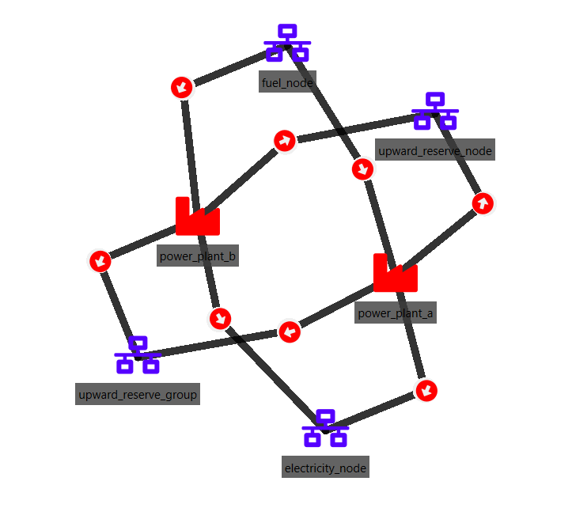
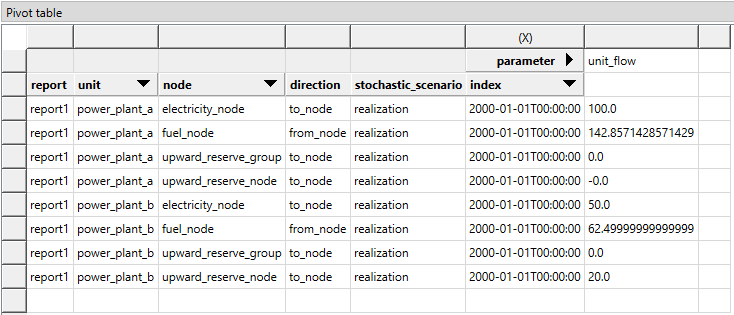
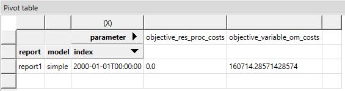
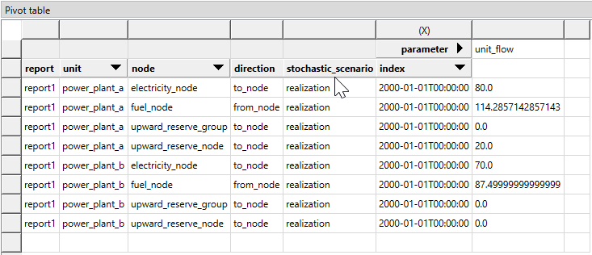
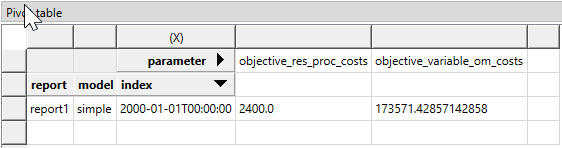

# [Reserve definition tutorial](@id reserves-tutorial)

This tutorial provides a step-by-step guide to include reserve requirements in a simple energy system with Spine Toolbox for SpineOpt.

## Introduction

Welcome to our tutorial, where we will walk you through the process of adding a new reserve node in SpineOpt using Spine Toolbox. To get the most out of this tutorial, we suggest first completing the [Simple system tutorial](@ref).

Reserves refer to the capacity or energy that is kept as a backup to ensure the power system's reliability. This reserve capacity can be brought online automatically or manually in the event of unforeseen system disruptions such as generation failure, transmission line failure, or a sudden increase in demand. Operating reserves are essential to ensure that there is always enough generation capacity available to meet demand, even in the face of unforeseen system disruptions.

### Model assumptions

- The reserve node has a requirement of 20 MW for upward reserve
- Power plants 'a' and 'b' can both provide reserve to this node
- The electricity demand (150 MW) and the power plants are the same as in the [Simple system tutorial](@ref)

## Guide

### Starting point

You can either continue from your own Simple system project, or start from the example file:

1. Create a workflow in Spine Toolbox with an input database, a Run SpineOpt tool and an output database, as on the [Verify installation](@ref recommended_workflow) page.
2. Double-click the input database to open it in the Spine DB editor.
3. Select **File > Import...** and import the [simple system example file](https://github.com/spine-tools/SpineOpt.jl/blob/master/examples/simple_system.json).
4. Press **Commit** in the toolbar.

The example file names the nodes `electricity_node` and `fuel_node`. If you built the system yourself in the Simple system tutorial, your nodes may be called `electricity` and `fuel`; use your own names in the steps below.

!!! note
    In the Parameter value table, the first row is a filter row. Enter new values on the empty row below it.

### Adding the reserve node and group

In SpineOpt, a reserve is modelled as a separate node. To link the reserve to electricity production, we also create a node group that contains both the electricity node and the reserve node.

1. In the *Entity tree* (typically on the left), right-click the [node](@ref) class and select **Add entities...**
2. Enter the name `upward_reserve_node` and press **OK**.
3. Right-click the [node](@ref) class again and select **Add entity group...**
4. Enter `upward_reserve_group` as the *Group name*, add `electricity_node` and `upward_reserve_node` as members, and press **OK**.

!!! note
    In SpineOpt, groups of nodes allow the user to create constraints that involve variables from its members. Here, the group `upward_reserve_group` links the flow variables for electricity production and reserve procurement, so that a unit cannot use the same capacity for both.

### Connecting the units to the reserve node and group

Both power plants can provide reserve, so they need a flow to the reserve node and to the group.

1. In the Entity tree, right-click the [unit\_\_to\_node](@ref) class and select **Add entities...**
2. Add the following four entities (unit first, then the **receiving** node) and press **OK**:

| unit | node |
|:---|:---|
| power\_plant\_a | upward\_reserve\_node |
| power\_plant\_b | upward\_reserve\_node |
| power\_plant\_a | upward\_reserve\_group |
| power\_plant\_b | upward\_reserve\_group |

To see the reserve procurement costs in the results, we also add two outputs to the report:

3. Right-click the [report\_\_output](@ref) class and select **Add entities...**
4. Add `report1 | variable_om_costs` and `report1 | res_proc_costs` and press **OK**.

This will write the total [vom\_cost](@ref) and reserve procurement cost terms of the objective function to the output database as part of *report1* (see also [How to manage Output Data](@ref)).

### Entering the parameter values

Select each entity in the Entity tree and enter the values below in the Parameter value table, always with the alternative `Base`. For the values marked *(list)*, double-click the value cell and pick the value from the drop-down list.

| Entity class | Entity | Parameter | Value |
|:---|:---|:---|:---|
| node | upward\_reserve\_node | [demand](@ref) | 20.0 |
| node | upward\_reserve\_node | [reserve\_active](@ref) | True *(list)* |
| node | upward\_reserve\_node | [reserve\_upward](@ref) | True *(list)* |
| node | upward\_reserve\_node | [balance\_sense](@ref) | >= *(list)* |
| node | upward\_reserve\_group | [balance\_type](@ref) | none *(list)* |
| unit\_\_to\_node | power\_plant\_a ǀ upward\_reserve\_node | [capacity\_per\_unit](@ref) | 100.0 |
| unit\_\_to\_node | power\_plant\_b ǀ upward\_reserve\_node | [capacity\_per\_unit](@ref) | 200.0 |
| unit\_\_to\_node | power\_plant\_a ǀ upward\_reserve\_group | [capacity\_per\_unit](@ref) | 100.0 |
| unit\_\_to\_node | power\_plant\_b ǀ upward\_reserve\_group | [capacity\_per\_unit](@ref) | 200.0 |

What the values do:
- [demand](@ref) sets the reserve requirement of 20 MW.
- [reserve\_active](@ref) makes the node a reserve node, and [reserve\_upward](@ref) sets the direction of the reserve.
- [balance\_sense](@ref) `>=` means that the procured reserve must be greater than or equal to the reserve demand.
- [balance\_type](@ref) `none` on the group means that no extra balance is created between the members of the group.
- [capacity\_per\_unit](@ref) on the reserve node sets how much reserve each unit can provide. Here it is equal to the unit capacity for the electricity node, but it can be lower if the unit cannot provide reserves with its total capacity.
- [capacity\_per\_unit](@ref) on the group sets the total capacity of each unit for electricity and reserve together.

!!! warning
    All nine values are needed. If some of them are missing, the model can become infeasible or give unexpected results.

Press **Commit** in the toolbar when you are done.

### Executing the workflow

Go back to Spine Toolbox's main window and press the **Project** button in the *Execute* section of the toolbar. Select the Run SpineOpt tool to follow the output of SpineOpt in the console.

### Examining the results

1. Double-click the output database to open it in the Spine DB editor.
2. Press **Index** in the toolbar to switch to the pivot table view.
3. Select `report__unit__node__direction__stochastic_scenario` in the Entity tree.
4. In the *Frozen table*, select the alternative of the latest run. By default the Frozen table shows the oldest run, and every run adds a new "Run SpineOpt@..." alternative.

You should see the following [unit\_flow](@ref var_unit_flow) values:

| unit | node | unit\_flow |
|:---|:---|---:|
| power\_plant\_a | electricity\_node | 100.0 |
| power\_plant\_a | upward\_reserve\_node | 0.0 |
| power\_plant\_b | electricity\_node | 50.0 |
| power\_plant\_b | upward\_reserve\_node | 20.0 |

As anticipated, *power\_plant\_b* is supplying the necessary reserve due to its surplus capacity, while *power\_plant\_a* is operating at full capacity. Additionally, in this model, we have not allocated a cost for reserve procurement. To check this, select `report__model` in the Entity tree: `objective_res_proc_costs` is 0.0 and `objective_variable_om_costs` is 160714.29.

So, is it possible to assign costs to this reserve procurement in SpineOpt? Yes, it is indeed possible.

### Adding a reserve procurement cost

Open the input database again and add the following values (alternative `Base`):

| Entity class | Entity | Parameter | Value |
|:---|:---|:---|:---|
| unit\_\_to\_node | power\_plant\_a ǀ upward\_reserve\_node | [reserve\_procurement\_cost](@ref) | 5.0 |
| unit\_\_to\_node | power\_plant\_b ǀ upward\_reserve\_node | [reserve\_procurement\_cost](@ref) | 35.0 |

Press **Commit**, go back to Spine Toolbox's main window and press **Project** again.

### Examining the results again

View the results as before, and remember to select the latest run in the Frozen table. You should now see:

| unit | node | unit\_flow |
|:---|:---|---:|
| power\_plant\_a | electricity\_node | 80.0 |
| power\_plant\_a | upward\_reserve\_node | 20.0 |
| power\_plant\_b | electricity\_node | 70.0 |
| power\_plant\_b | upward\_reserve\_node | 0.0 |

Since the cost of reserve procurement is much cheaper in *power\_plant\_a* than in *power\_plant\_b*, the optimal solution is to reduce the production of electricity in *power\_plant\_a* to provide reserve with this unit rather than *power\_plant\_b* as before. In `report__model`, the reserve procurement costs are no longer zero: `objective_res_proc_costs` is 2400.0 (20 MW × 5 €/MWh × 24 h) and `objective_variable_om_costs` is 173571.43.

