# Simple system tutorial

In this tutorial you build a simple energy system from scratch with Spine Toolbox and run it with SpineOpt. Spine Toolbox is used to create a workflow with databases and tools, and SpineOpt is the tool that optimises the energy system. The later tutorials build on this one.

!!! info
    If you haven't installed the tools yet, follow the [Spine Toolbox installation guide](https://github.com/spine-tools/Spine-Toolbox#installation) and the [SpineOpt installation guide](@ref installation).

## Overview

In this tutorial we will:
+ create a workflow with an input database, SpineOpt and an output database,
+ prepare the input database with the SpineOpt templates,
+ add the nodes and units of the system and the flows between them,
+ enter the parameter values,
+ and run the workflow and check the results.

## About the simple system

-   Two power plants take fuel from a source node and release
    electricity to another node in order to supply a demand.
-   Power plant 'a' has a capacity of 100 MW, a variable operating cost
    of 25 euro/fuel unit, and generates 0.7 MWh of electricity per unit
    of fuel.
-   Power plant 'b' has a capacity of 200 MW, a variable operating cost
    of 50 euro/fuel unit, and generates 0.8 MWh of electricity per unit
    of fuel.
-   The demand at the electricity node is 150 MW.
-   The fuel node is able to provide infinite energy.

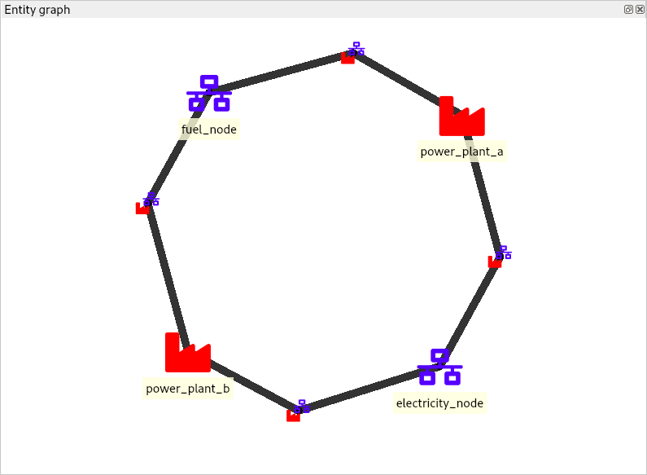

## Spine Toolbox workflow

The workflow is a SpineOpt tool that reads data from an input database, optimises the system and writes the results to an output database.

1. Drag two **Data Store** items and a **Run SpineOpt** tool from the toolbar to the *Design View*, and name the Data Stores `input` and `output`.

    The *Data Store* is in the *Main* section of the toolbar. *Run SpineOpt* comes from the SpineOpt plugin and is in the *SpineOpt* section. If the window is narrow, that section may be hidden at the right end of the toolbar: click the arrow there or widen the window. If you don't see it at all, install the plugin first (**Plugins > Install plugin...**, see [Installation](@ref installation)).

2. Select each Data Store, select the dialect *sqlite* in its properties panel and press **New Spine db**.
3. Connect `input` to Run SpineOpt and Run SpineOpt to `output` by dragging arrows between the items.
4. The arrows only make the databases available to the tool. In the properties panel of Run SpineOpt, drag the databases to the **Tool arguments**, first the input and then the output:

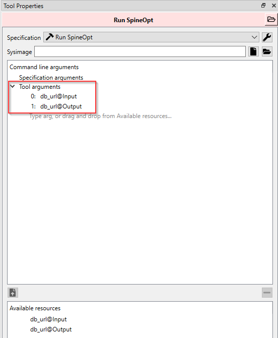

The result should look similar to this. The *Load template* tool in the picture is another way to load the SpineOpt template; we don't need it here.

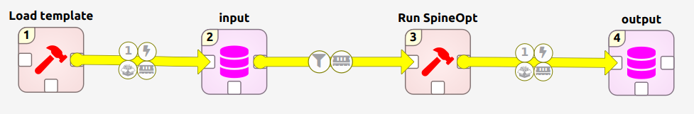

## Entering input data

We enter the data with the *Spine DB editor*. Double-click the `input` Data Store to open it.

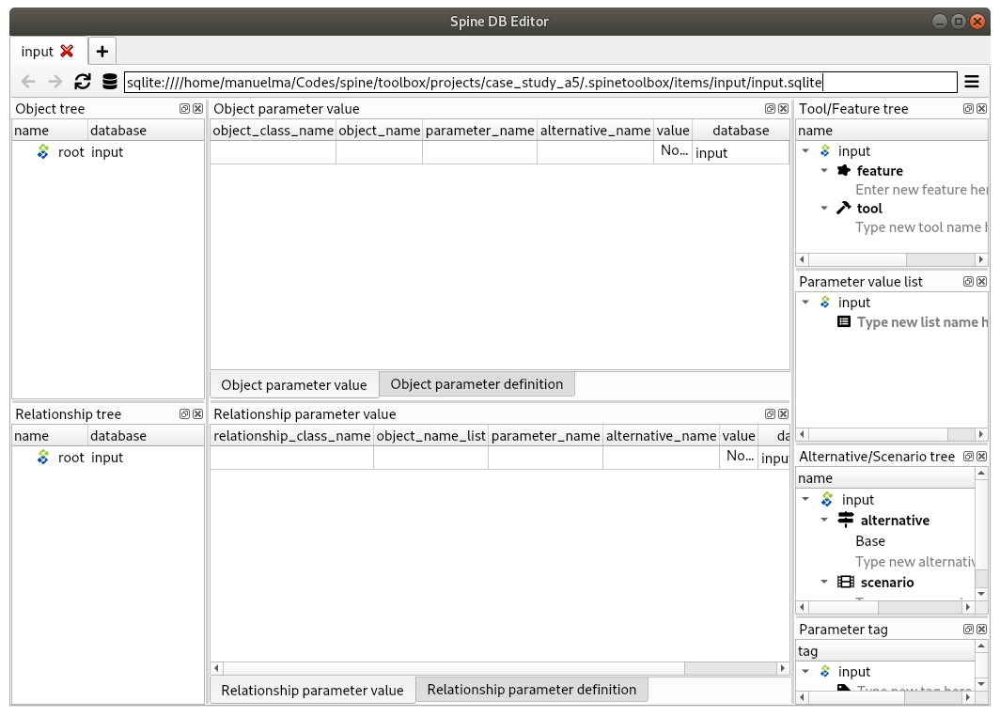

How the editor works in the steps below:
- **Entities** (nodes, units, flows, ...) are added in the *Entity tree* at the top-left: right-click the class, select **Add entities...** and fill in the dialog.
- **Parameter values** are entered in the *Parameter value* table: select the class in the Entity tree and fill in the entity byname, parameter name, alternative and value on the empty row below the filter row. Use the alternative `Base`. For values marked *(drop-down)*, double-click the value cell and pick the value from the list. A completed row shows the icon of its class; a row without an icon is incomplete and won't be saved.
- Changes are saved only when you press **Commit** in the toolbar.
- The **Graph** button in the toolbar shows the entities that you select in the Entity tree as a graph.

### Templates and model settings

An empty database doesn't yet know the entity classes and parameters of SpineOpt. We get them from the SpineOpt template. The model settings, i.e. the model, its temporal and stochastic structure and the report, come from a second template.

1. Download [the SpineOpt database template](https://github.com/spine-tools/SpineOpt.jl/blob/master/templates/spineopt_template.json) and [the basic SpineOpt model](https://github.com/spine-tools/SpineOpt.jl/blob/master/templates/models/basic_model_template.json) with the **Download raw file** button at the top right of the file view.
2. Select **File > Import...** and import first `spineopt_template.json` and then `basic_model_template.json`. The order matters: the basic model can only be imported once the classes of the template exist. You should then see classes like *connection*, *grid* and *model* in the Entity tree.
3. Press **Commit** and enter a commit message, e.g. 'Import templates'.

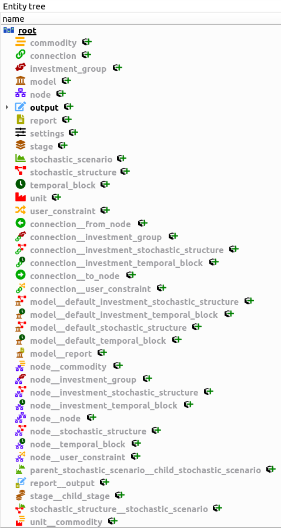

The report determines which variables are written to the output database. It has no outputs yet, so we connect it to the [unit\_flow](@ref var_unit_flow) variable. The connection is an entity of the [report\_\_output](@ref) class, so it is added in the Entity tree and has no parameter value.

4. Right-click the [report\_\_output](@ref) class, select **Add entities...**, fill in only the *report* and *output* columns and press **OK**:

| report | output |
|:---|:---|
| report1 | unit\_flow |

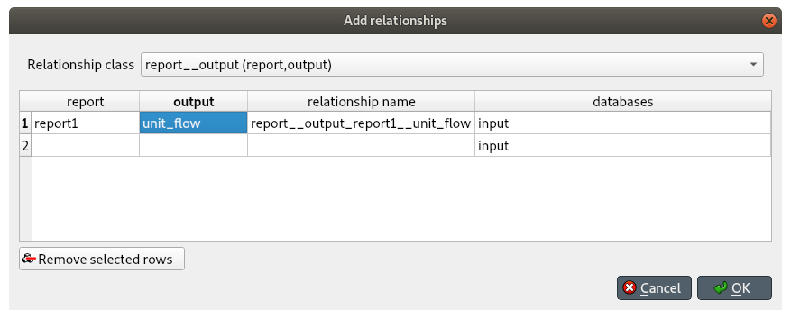

The resulting model settings are shown below (select the model, the stochastic structure and the report in the Entity tree). The *realization* entity is a scenario, which SpineOpt needs even for a deterministic model; see the [Stochastic structure tutorial](@ref).

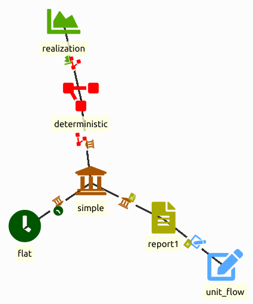

### Nodes and units

In SpineOpt, nodes are points where an energy balance takes place, whereas units are energy conversion devices that take energy from nodes and release it to nodes.

1. Right-click the [node](@ref) class, select **Add entities...**, add `fuel` and `electricity` and press **OK**.

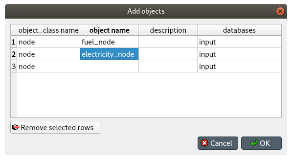

2. Add the units `power_plant_a` and `power_plant_b` to the [unit](@ref) class in the same way.

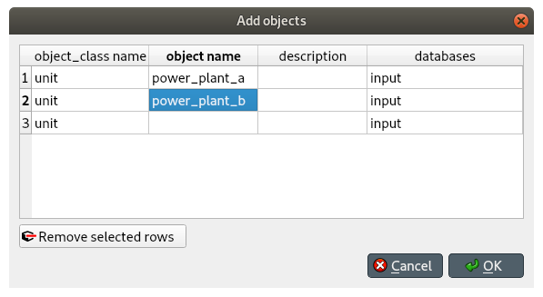

!!! info
    The example file [simple\_system.json](https://github.com/spine-tools/SpineOpt.jl/blob/master/examples/simple_system.json)
    of the [Verify installation](@ref recommended_workflow) page contains the same system,
    with the nodes called *fuel\_node* and *electricity\_node*.

### Flows between the nodes and units

Fuel flows from the 'fuel' node to the units, and electricity from the units to the 'electricity' node.

1. Add the flows from the 'fuel' node to the units to the [node\_\_to\_unit](@ref) class:

| node | unit |
|:---|:---|
| fuel | power\_plant\_a |
| fuel | power\_plant\_b |

2. Add the flows from the units to the 'electricity' node to the [unit\_\_to\_node](@ref) class:

| unit | node |
|:---|:---|
| power\_plant\_a | electricity |
| power\_plant\_b | electricity |

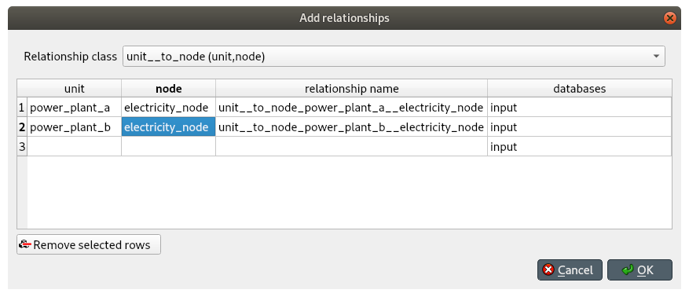

These flows are independent of each other: nothing yet says how much fuel a unit needs for its electricity. That is defined between the input and the output flow of the unit with a [unit\_flow\_\_unit\_flow](@ref) entity, which later gets the efficiency. Defining the efficiency between flows rather than for the unit allows units with several inputs and outputs, e.g. a CHP plant.

3. Add the following entities to the [unit\_flow\_\_unit\_flow](@ref) class. The dialog has two columns: the first one is the output flow of the unit and the second one its input flow.

| unit\_flow (output) | unit\_flow (input) |
|:---|:---|
| power\_plant\_a ǀ electricity | fuel ǀ power\_plant\_a |
| power\_plant\_b ǀ electricity | fuel ǀ power\_plant\_b |

4. Press **Commit**.

The resulting system is shown below (select the nodes in the Entity tree):

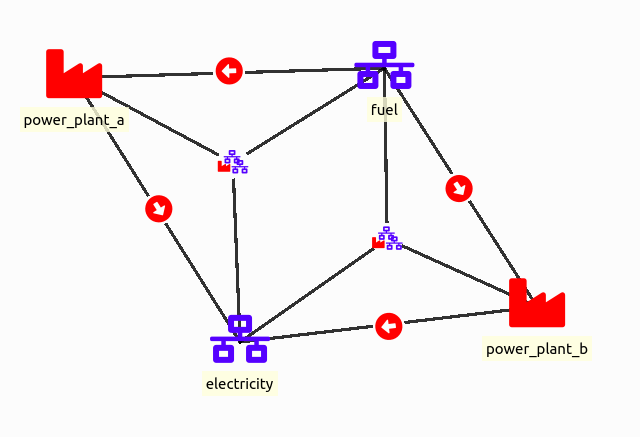

### Parameter values

The parameters of the power plants are given for the flows rather than for the units, because a unit can have several inputs and outputs:

| parameter | given for | why |
|:---|:---|:---|
| VOM cost | [node\_\_to\_unit](@ref) *fuel ǀ power\_plant* | it is paid for the fuel input |
| capacity | [unit\_\_to\_node](@ref) *power\_plant ǀ electricity* | it limits the electricity output |
| efficiency | [unit\_flow\_\_unit\_flow](@ref) | it is the ratio of the output to the input |

The fuel node gets the [balance\_type](@ref) `none`, so that it doesn't have to balance its flows and can supply any amount of fuel.

1. Select the [node](@ref) class and enter:

| group | class | entity byname | parameter name | alternative | value |
|:---|:---|:---|:---|:---|:---|
| | node | electricity | [demand](@ref) | Base | 150.0 |
| | node | fuel | [balance\_type](@ref) | Base | none *(drop-down)* |

2. Select the [node\_\_to\_unit](@ref) class and enter:

| group | class | entity byname | parameter name | alternative | value |
|:---|:---|:---|:---|:---|:---|
| | node\_\_to\_unit | fuel ǀ power\_plant\_a | [vom\_cost](@ref) | Base | 25.0 |
| | node\_\_to\_unit | fuel ǀ power\_plant\_b | [vom\_cost](@ref) | Base | 50.0 |

3. Select the [unit\_\_to\_node](@ref) class and enter:

| group | class | entity byname | parameter name | alternative | value |
|:---|:---|:---|:---|:---|:---|
| | unit\_\_to\_node | power\_plant\_a ǀ electricity | [capacity\_per\_unit](@ref) | Base | 100.0 |
| | unit\_\_to\_node | power\_plant\_b ǀ electricity | [capacity\_per\_unit](@ref) | Base | 200.0 |

4. Select the [unit\_flow\_\_unit\_flow](@ref) class and enter:

| group | class | entity byname | parameter name | alternative | value |
|:---|:---|:---|:---|:---|:---|
| | unit\_flow\_\_unit\_flow | power\_plant\_a ǀ electricity ǀ fuel ǀ power\_plant\_a | [flow\_ratio\_equality\_coefficient](@ref) | Base | 0.7 |
| | unit\_flow\_\_unit\_flow | power\_plant\_b ǀ electricity ǀ fuel ǀ power\_plant\_b | [flow\_ratio\_equality\_coefficient](@ref) | Base | 0.8 |

The [flow\_ratio\_equality\_coefficient](@ref) is the ratio of the first (output) flow to the second (input) flow. If the flows are the wrong way round, the results are wrong or SpineOpt stops with an error.

5. Press **Commit**.

Select the root in the Entity tree to see all parameter values. Besides the values above, it shows the [resolution](@ref) `1D` of the temporal block *flat* from the basic model template, i.e. the model has one time step of one day.

## Executing the workflow

In Spine Toolbox's main window, press **Project** in the *Execute* section of the toolbar. The *Event log* shows the progress, and selecting the Run SpineOpt tool shows the output of SpineOpt in the *Julia Console*.

## Examining the results

1. Double-click the `output` Data Store to open it in the Spine DB editor.
2. Press the **Index** button in the toolbar to show the results in a pivot table.
3. In the Entity tree, select `report__unit__node__direction__stochastic_scenario`.
4. Under alternative in the *Frozen table*, pick the latest run ("Run SpineOpt@..."). Each run is saved as its own alternative.

You should get the following [unit\_flow](@ref var_unit_flow) results:

| report | unit | node | direction | stochastic\_scenario | index | unit\_flow |
|:---|:---|:---|:---|:---|:---|---:|
| report1 | power\_plant\_a | electricity | to\_node | realization | 2000-01-01T00:00:00 | 100.0 |
| report1 | power\_plant\_a | fuel | from\_node | realization | 2000-01-01T00:00:00 | 142.86 |
| report1 | power\_plant\_b | electricity | to\_node | realization | 2000-01-01T00:00:00 | 50.0 |
| report1 | power\_plant\_b | fuel | from\_node | realization | 2000-01-01T00:00:00 | 62.5 |

The cheaper *power\_plant\_a* produces at its full capacity of 100, and *power\_plant\_b* covers the rest of the demand of 150. The fuel flows are the electricity flows divided by the efficiencies (100 / 0.7 and 50 / 0.8).
